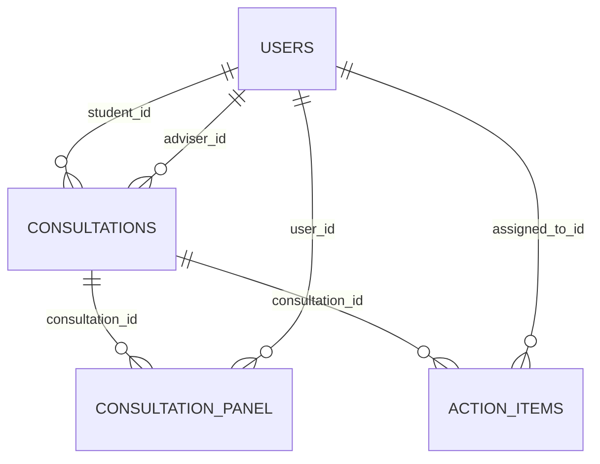

# Local consultation data foundation

Implemented at checkpoint 02, based on foundation commit `d43b0df`. This is a data milestone, not a working consultation API or proof of authorization/automation.

## Databases and safe setup

XAMPP's installed server was started on **127.0.0.1:3306**, using its existing my.ini with a loopback bind override. Actual connection reports MariaDB 10.4.32. No existing database was selected, reset or deleted. Startup emitted a warning about the existing system replication-state table; no system-table repair was attempted. Successful project migrations/tests do not certify the entire XAMPP installation.

| Purpose | Database | Account / host |
| --- | --- | --- |
| Running local prototype | thesis_consultation_week13 | thesis_week13@127.0.0.1 |
| Disposable automated tests only | thesis_consultation_week13_test | thesis_week13_test@127.0.0.1 |

Each account has SELECT, INSERT, UPDATE, DELETE, CREATE, ALTER, DROP, INDEX and REFERENCES on **its own database only**, with no global administration or grant option. DDL permissions support local migrations/tests; the prototype currently shares a migration/runtime account. A production arrangement would separate migration and runtime permissions. The application does not use root. The one-time setup used the available default local XAMPP admin connection; no archived settings or password were consulted.

`backend/tools/provision-local.php` creates only these fixed unused names, generates fresh random database/demo passwords, preserves the existing app key and writes secrets only to ignored `.env` / `.env.testing`. It refuses existing target databases/accounts, customized app settings or an existing `.env.testing`. It does not overwrite/reset existing databases. Database/account creation is not transactional: if setup stops partway, inspect the new named resources and local files manually; do not rerun or delete things blindly.

**The current workspace is already provisioned and migrated. Do not repeat the fresh-checkout commands here.** For another fresh local checkout on the same machine, these names already exist: the script will refuse them. Use a separate approved empty environment or deliberately arrange fresh names/settings rather than reconnecting historical credentials.

For a fresh checkout on an empty controlled XAMPP environment with these names unused:

```powershell
Set-Location 'C:\Users\Laure\Documents\ChatGPT\IPT\week-13\backend'
composer install --no-interaction
Copy-Item .env.example .env
php artisan key:generate
# Start the installed XAMPP MySQL service first; confirm port 3306 is free.
php tools/provision-local.php
php artisan config:clear
php artisan migrate --no-interaction
php artisan db:seed --no-interaction
php artisan test
php tools/inspect-data.php
```

For a non-default local administrative login, the provisioning tool reads `DB_SETUP_USER` and `DB_SETUP_PASSWORD` from the process environment. Supply private values locally; do not paste them into chat, commit them or put them in screenshot-visible commands. Clear those variables afterward. Do not change XAMPP authentication or reuse an archived password to make setup succeed. The example files contain no working secrets.

## Schema and rationale



- `users.role`: student, adviser, panel or coordinator. The default is the least-privileged student role. `role` is excluded from the model's mass-assignable fields; the controlled seeder sets it explicitly. This is not a complete permission system.
- `consultations`: unique reference, student/adviser links, agenda, requested/confirmed/completed/missed status, UTC start/end, schedule version and optional meeting notes. Indexes support later approaching-start and elapsed-end scans. Requested records have no schedule and version 0; other states require a complete positive-duration schedule and version at least 1. MariaDB enforces that check.
- `consultation_panel`: explicit panel membership per consultation; composite primary key blocks duplicate links.
- `action_items`: consultation/student link, short description, UTC deadline, positive deadline version, nullable completion time. An index supports later overdue/open scans. Completion time indicates recorded completion; adviser acceptance is not inferred.
- Foreign keys reject missing referenced users/consultations and restrict deletion of referenced records. Historical rows are not silently cascaded away. There is no deletion API.
- Conventional Eloquent models expose student, adviser, panelMembers, actionItems, consultation and assignedTo relationships. API code must use validated, authorized fields rather than passing arbitrary request data into model creation.

Roles of referenced users, correct student-to-action ownership, permitted state transitions, agenda length, future schedule rules and adviser approval remain **server workflow-validation/authorization work for the next milestone**. Database shape alone cannot prove them. `meeting_notes` and fictional agendas stay out of routine diagnostic logs. No automation work records, audit-event log or notification delivery exist yet.

MariaDB-specific CHECK statements are intentional for this approved database stack. The suite tests the actual MariaDB engine rather than claiming SQLite equivalence. Schedule/deadline versions prepare only the identity needed for required duplicate/stale-work controls; those controls are not implemented by merely adding the columns.

## Fictional fixtures and credentials

The local/testing-only seeder requires a private `DEMO_PASSWORD` of at least 16 characters. Fresh setup generates one; the User model uses Laravel's password hashing cast. No real personal accounts or records are imported. The password/hash are excluded from inspection output and screenshots.

| Account | Role |
| --- | --- |
| student.one@example.test; student.two@example.test | Student |
| adviser.one@example.test; adviser.two@example.test | Adviser |
| panel.one@example.test | Panel |
| coordinator.one@example.test | Coordinator |

These are future login fixtures; **login is not implemented yet**. Read the generated demo password privately from local `.env` when login becomes available; do not copy the file into evidence. Unit/integration tests use an explicitly fictional test-only password instead of publishing the generated local credential.

The seeder creates three marked fixtures: DEMO-REQUEST-001 (requested), DEMO-CONFIRMED-001 (scheduled tomorrow, one panel link), DEMO-COMPLETED-001 (yesterday, one action item due in two days). “Completed” is an initial fictional fixture, not evidence that a meeting actually happened or that a workflow action ran. UTC dates are relative to the initial seed time; rerunning preserves their original values, edited agendas, completion and password hashes. Existing mismatched demo roles stop the seeder for manual review.

## Repeatable checks in the current workspace

```powershell
Set-Location 'C:\Users\Laure\Documents\ChatGPT\IPT\week-13\backend'
php artisan migrate:status
php artisan test
php vendor/bin/pint --test
php tools/inspect-data.php
```

`phpunit.xml` forces the test connection/database/account. The base TestCase validates database, user, loopback host/port and absence of a connection URL/socket **during application creation, before RefreshDatabase runs**. The test user has no app-database privileges. RefreshDatabase may rebuild only the dedicated test schema and rolls back test changes; never run `migrate:fresh` on the running app database. `.env.testing` supplies its own private password/key. A missing or misconfigured test environment must fail, not silently fall back to the app.

`inspect-data.php` reads safe fixture metadata/counts from the app database and checks that its account is denied a SELECT on the test database. It emits no passwords/hashes and performs no writes. The actual result was SQLSTATE 42000, MariaDB error 1142 (denied), with stable app counts before/after repeat seeding.

See [actual results](../evidence/test-results/DATA-RESULTS.md) and the [commit checkpoint](CHECKPOINT-02.md). The Flutter screen is unchanged from the foundation; no new browser workflow evidence is claimed.

## Framework references

- [Laravel 12 migrations and constraints](https://laravel.com/docs/12.x/migrations)
- [Laravel 12 database testing](https://laravel.com/docs/12.x/database-testing)
- Installed framework `RefreshDatabase` and base `TestCase` implementations were inspected to place the safety guard before resetting tests.
