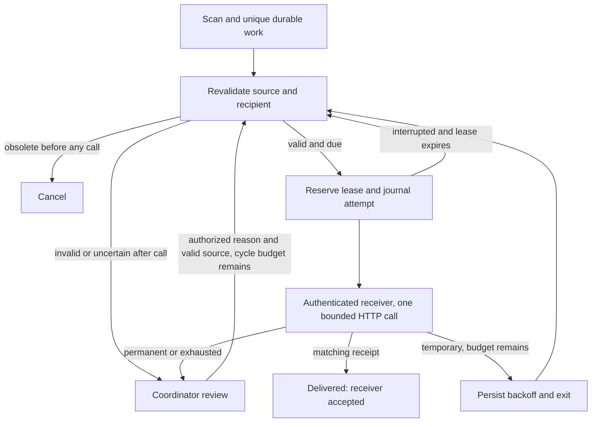

# Bounded delivery and coordinator recovery

Checkpoint 07 update: the [Flutter workflow/review UI](FLUTTER.md) now exposes these endpoints. [Actual browser recovery](../evidence/test-results/FLUTTER-RESULTS.md) verified new work19 from422 to recorded cycle2 recovery and one accepted receipt. Current captured state is18 accepted/3 pending/1 needs_review; earlier result counts below describe checkpoint06. Full activities/SA7/student review and automated Flutter test execution remain unfinished.

Checkpoint 06, 2026-10-29. This extends [the scan contract](AUTOMATION.md). Policy choices below are implementation decisions for a controlled classroom prototype. A delivered row means the separate loopback receiver accepted the minimal notification and returned a matching receipt. It does not prove email/SMS delivery, user reading, real attendance or stakeholder acceptance.

## Execution and boundaries

`consultations:scan` writes durable work in MariaDB. `automation:work --limit=20` reads at most 20 due rows (maximum configurable batch 50) and exits. Both are registered every minute with individual two-minute overlap locks. No continuous scheduler is currently running. Manual processing and the real receiver were verified; the combined continuous scheduling arrangement is not yet a long-running reliability demonstration.

The worker validates the current source, roles, recipient, version, timestamp, payload allowlist, review owner and derived unique identity before each claim. An obsolete source before the first attempt cancels without HTTP. A source that changes after an attempt requires review because a remote receipt may already exist. Invalid records go to `needs_review`. Progress summaries retain the first-scan daily snapshot rather than recomputing a different payload under an existing identity.

Within a short MariaDB row-lock transaction, it reserves a random claim token for 30 seconds, increments counters and creates a durable `started` attempt. HTTP occurs after commit, so a network wait does not hold the row lock. Finishing requires the same claim token; a late worker cannot overwrite a newer owner. An expired lease closes its prior journal entry as `interrupted` before retrying within the remaining attempt budget. An unexpected exception after reservation leaves that durable claim for later reconciliation. No attempt history is erased.



## Service contract and fault policy

Only `http://127.0.0.1:8090/notify` is accepted by this worker; redirects are disabled. Bearer authentication uses a newly generated shared key in two ignored local `.env` files. Flutter never receives it. Connection timeout is two seconds, total HTTP timeout five seconds, one call per reserved attempt. No nested framework HTTP retry is enabled.

Request JSON: `work_key` (SHA-256 identity), stable work `correlation_id`, `kind`, numeric `recipient_id`, UTC `scheduled_for`, minimal `data`. Reminder data contains consultation/version IDs; deadline data action/version IDs; missed data source ID, explicit inferred basis/human-review flag/transition correlation; summary data adviser ID/local date/bounded counts. No agenda, message notes, password or email address is sent. A 2xx response must contain the same work key and a receipt matching `rcpt_` plus 32 lowercase hexadecimal characters.

| Outcome | Decision |
| --- | --- |
| Valid matching 2xx receipt | Persist delivered and receipt |
| Connection/timeout, 429, 5xx | Retry only while attempts < 3 |
| Other HTTP status or malformed successful receipt | Immediate coordinator review |
| Third failed attempt | Coordinator review; no fourth automatic call |
| Expired claim | Journal interrupted; revalidate and use remaining budget |
| Active claim or future available_at | No call |

Backoff after failures is **30–35 seconds**, then **60–65 seconds**, including 0–5 seconds jitter. These are earliest eligibility times; minute scheduling or unavailable operators can delay processing. Each work has at most three cycles, each at most three attempts. Two manual recoveries therefore allow at most nine reserved attempts total; recovery preserves the original identity, immutable payload, old journal and total count.

The separate PHP receiver uses the installed PDO SQLite extension solely for its small idempotency ledger; consultation/work data remains in XAMPP MariaDB. SQLite requires no extra server or package. A serialized receipt transaction stores identity, payload hash, receipt and acceptance time, not the notification body. Duplicate identity + identical payload returns the original receipt; a conflicting payload returns 409. The private ledger must be retained across receiver restarts for this guarantee. A missing/restored-old ledger can permit duplicate acceptance; backups and production deployment are outside this milestone.

`/test/control` is authenticated with the same key and exists only in this controlled receiver. Its per-work modes are success, transient_once, permanent, unavailable, ack_loss_once, timeout_once. Lost acknowledgment accepts once then returns 503; timeout accepts once then waits six seconds. Repeating either request returns its original receipt. This receiver must not be exposed publicly or presented as a real messaging provider. HTTP has no transport encryption; Week 14 remains separate.

## Setup and operations

In a **fresh checkout**, after the existing Laravel/database setup, with no service key/configuration yet:

```powershell
Set-Location 'C:\Users\Laure\Documents\ChatGPT\IPT\week-13\backend'
php tools/configure-notifications.php
php artisan migrate --no-interaction
Set-Location '..\notification-service'
php -S 127.0.0.1:8090 -t public public/index.php
```

Configuration already exists in this workspace. Do not rerun the initializer, rotate keys, overwrite settings or delete the ledger. It refuses existing configuration. Inspect occupied ports/processes before launches. Keep the receiver terminal running; Ctrl+C stops that terminal's receiver. `GET /health` is public loopback liveness only, not storage readiness.

In another terminal, run a bounded scan then delivery when intended:

```powershell
Set-Location 'C:\Users\Laure\Documents\ChatGPT\IPT\week-13\backend'
php artisan consultations:scan
php artisan automation:work --limit=20
php artisan schedule:list
```

These commands can create/process later due fictional data. They are operational actions, not harmless snapshots. Do not rerun fixture-generating verification scripts to refresh timestamps. `tools/verify-delivery.php init` refuses an existing evidence manifest; the recorded run is retained. `tick` honors actual due times. `recover` is a one-time controlled API exercise; do not repeat it against delivered work. `verify` checks the retained run and performs bounded duplicate/invalid/auth probes; `snapshot` reads it.

## Human review and recovery runbook

1. Coordinator signs in and reads `GET /api/automation` and `/api/automation/{id}`. Inspect source, failure code, attempt times/statuses and receipt uncertainty. Keep correlation ID for investigation. Panel members cannot use automation endpoints; students/advisers see their own currently authorized recipient records. `GET /api/notifications` contains only the signed-in user's delivered records.
2. Resolve the dependency/configuration issue privately. Do not paste keys, cookies, raw exceptions or note bodies into logs. A configuration error stops the worker before a new claim. Durable prior claims/attempts remain inspectable.
3. Coordinator sends `POST /api/automation/{id}/recover` with a 10–500 character `reason`. Session/CSRF, role, current state/source, no stored receipt and remaining cycle budget are checked. A durable recovery row records actual actor/reason/new cycle; safe operational logs omit reason text.
4. Run bounded delivery when due, inspect matching receipt and retained history. A successful response from the recovery endpoint means queued, not delivered. Delivered or exhausted-cycle recovery returns 409. If source is invalid/obsolete, automatic recovery is refused: resolve the domain policy with the instructor/maintainer rather than editing the ledger or inventing an outcome.
5. If safe logging fails, delivery returns `log_status=unavailable` and the CLI fails visibly while keeping committed DB results. Recovery audit remains in the DB if its operational log fails; the recovery response currently does not signal that telemetry gap. Inspect DB journal as the authoritative record. Unexpected storage failures can require operator investigation; no automatic DB reset is authorized.

## Verification and limitations

[Delivery results](../evidence/test-results/DELIVERY-RESULTS.md) maps actual cases and retained failures. Thirteen new tests plus prior regressions pass: **63 tests / 314 assertions**. Actual lost-ack/timeout attempts reconcile one receipt, unavailable service stops at three, and authenticated coordinator recovery retains prior history. The interruption exercise initializes an accepted-but-unrecorded claim boundary and waits for real lease expiry; it is a simulation, not an actual process kill. Competing-process execution, sustained load, host reboot, ledger backup/restore, real messaging and continuous scheduling reliability are unverified.

`AutomationEligibility` is shared by worker and recovery so those checks agree. `AutomationDelivery` owns durable attempt/HTTP boundaries, while the existing scanner owns source discovery. These separate responsibilities keep HTTP out of scanner transactions without adding a queue server/package. There is still a gap between source validation and remote acceptance; later source changes cannot retract an accepted receipt. Needs-review work and telemetry require a coordinator/maintainer; no claim of unattended production readiness is made. Full Flutter workflow/review screens and browser evidence, activities/SA7, maintainability evaluation and student defense remain pending.
