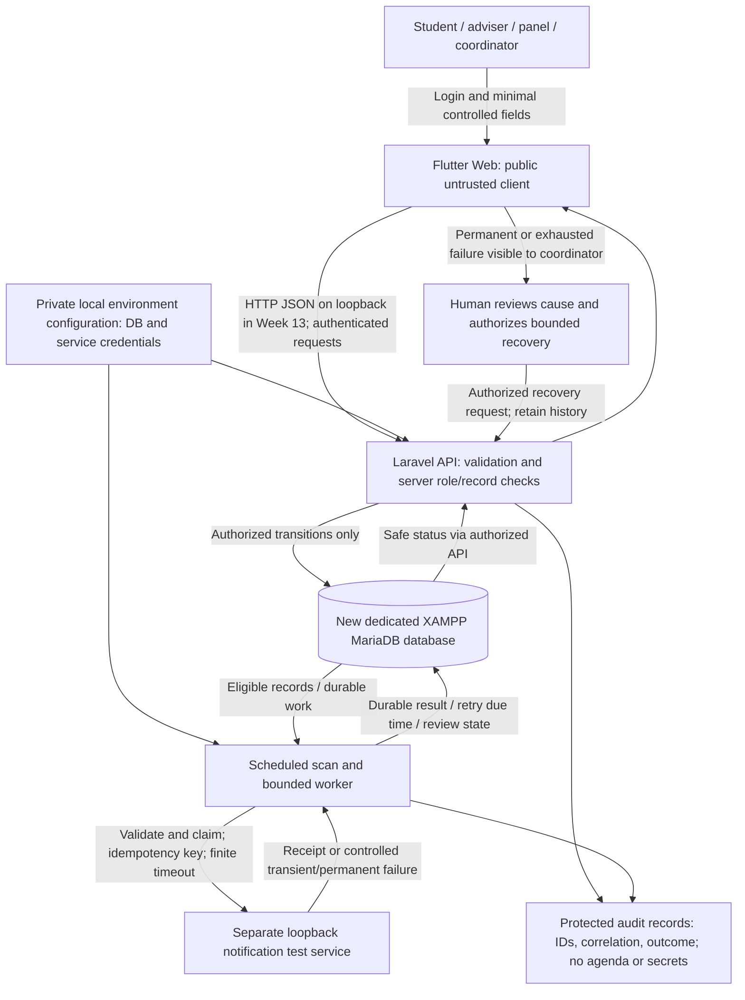

# Week 13 bounded design

Status: proposed implementation decisions, prepared before application code. Validate these decisions against execution evidence as each milestone is built.

Implementation update at checkpoint 02: the [data foundation](DATABASE.md) now implements roles, consultation/panel/action-item tables and models with fresh isolated MariaDB app/test databases. [Actual tests](../evidence/test-results/DATA-RESULTS.md) verify relationships, seed stability and constraints. Workflow/API permissions, audit and automation policies below remain proposals pending implementation. Seeded statuses are fictional fixtures, not execution of those policies.

Checkpoint 03 update supersedes the permission/request/schedule proposal: [API contract](API-CONTRACT.md) implements Sanctum cookie sessions, policies, scoped reads, student requests, assigned-adviser confirmation and transactional audit events. [Actual API evidence](../evidence/test-results/API-RESULTS.md) includes a retained request/confirmed record. Remaining mutations, UI and automation policies below are still pending; no notification/outbox behavior is implied by a schedule confirmation yet.

Checkpoint 04 update: manual meeting outcomes, action assignment/completion and participant follow-up now implement the bounded server workflow; see [workflow evidence](../evidence/test-results/WORKFLOW-RESULTS.md). Follow-up author/assignee come from the server, notes are appended, and repeat action completion creates no extra audit. No Flutter workflow or automation behavior is implied by these API results; all four required automations remain pending.

Checkpoint 05 update: [four-kind durable scans](AUTOMATION.md) now implement eligibility, unique work identities, bounded candidate checks and explicit automated missed inference/audit. [Actual scan evidence](../evidence/test-results/SCAN-RESULTS.md) proves pending records and duplicates avoided, not notification delivery. The first coordinator by ID owns reviews; daily summaries are first-scan snapshots. Delivery/retry/receipt/stale-claim recovery and Flutter views remain pending. The actual scan cap stops visibly above 100 eligible candidates/category instead of implementing automatic pagination; this bounds the classroom exercise and remains a scale limitation.

## Scope and authority

The student reports on 2026-10-29 that the teacher assigned and approved Project 29, Thesis Consultation Reminder System, in response to the approval/registration status question. This is the student's confirmation, not an independent inspection of the official class registry. The student retains responsibility for checking the instructor's written approval/registry; this repository must never modify it. Deadline: October 30, 2026, Asia/Manila; submission time unspecified.

One fictional consultation workflow: student request and agenda -> assigned adviser confirms a schedule -> adviser records completed or missed meeting -> adviser assigns action items -> student records completion -> adviser reviews progress/follow-up. Automatic elapsed-session handling uses the missed state and coordinator review, rather than inventing a meeting outcome. No real university availability or policy is asserted.

The guide names users but supplies no full permission matrix. The following permissions and timings are implementation choices for a controlled prototype, not institutional policies.

| Actor | Proposed permissions and ownership |
| --- | --- |
| Student | Create/view own requests and agenda; view own confirmed schedule/action items; record completion of own assigned action items; view own notifications |
| Adviser | View assigned consultations; confirm schedule; record meeting status; assign/review action items; review assigned students' progress |
| Panel member | Read only consultations explicitly linked to them, agenda and recorded progress; no scheduling/recovery authority |
| Coordinator | Review all prototype workflow records and failed automation; authorize safe recovery; no silent alteration of adviser decisions |
| Scheduler/worker | Process only eligible durable automation records using server configuration; no interactive role impersonation |

Acceptance authority for the classroom deliverable is the instructor. Coordinator/adviser are fictional operational roles, not actual stakeholder approvals. The student must personally review, run and explain the work. AI assistance must be acknowledged under institutional policy.

Non-goals: thesis file storage, plagiarism checking, grades, automatic academic decisions, calendar synchronization, real email/SMS, production deployment, mobile packaging and later-week features. Use fresh fictional accounts and a new dedicated local database. Do not inspect or reuse archived credentials, evidence or code.

## Data flow and trust boundaries

The browser is outside the trust boundary: it cannot select a trusted role or protect private keys. The API and worker are trusted only within this local test arrangement. Database credentials stay in a fresh ignored backend environment file. The notification service is a separate failure boundary, accepts only minimal fictional metadata and must deduplicate deliveries. IDs, kind and timing are sufficient for routine logs; do not log passwords, bearer tokens, full request bodies or agendas. Local HTTP is a Week 13 limitation; HTTPS/authenticated encryption evidence belongs to Week 14.

## Decision record

Question: how can a student reliably demonstrate four time-sensitive automations without introducing production services or excessive infrastructure?

| Criterion | Scheduled database scan + durable work records (selected) | Event-only queue/webhooks |
| --- | --- | --- |
| Functional fit | Finds approaching deadlines and missed sessions; catches work after downtime | Fast on changes, but future due times still need scheduling |
| Reliability | Due records remain after restart; unique keys and claims must prevent duplicates | Broker delivery/reconnect and duplicate events require additional operation |
| Security | Local service and private configuration; server-controlled eligibility | Additional webhook signature/endpoint or broker credentials |
| Performance | Minute-level latency and database scans; index/batch work | Low event latency; broker overhead for this small workload |
| Effort/skills | Conventional Laravel command and database transactions; readable for defense | More infrastructure and event failure modes to explain |
| Ownership | Student runs scheduler and worker in demo; coordinator reviews failures | Broker/webhook operations also require a named owner |
| Verification | Explicit scan/process commands and controlled clock in tests | Must preserve delivery timing, ordering and broker evidence |

Consequences: the scheduled approach is not instant, requires a running scheduler and worker, and must bound batch size, attempts and service call time. Durable records are not proof of external delivery: reconcile via the service's receipt/idempotency key. Revisit the decision if measured volume or latency makes a one-minute scan unacceptable. Framework choice: Flutter Web for the required public client, Laravel 12 compatible with installed PHP 8.2, MariaDB through Laravel's MySQL connection. These choices do not establish production readiness.

## Automation trigger contract

Store timestamps consistently in UTC, display Asia/Manila. Test with a controlled clock; do not change the computer's clock. The following demonstration windows are choices to be made configurable.

| Automation | Eligibility / proposed trigger | Durable identity / output | Responsible role / human boundary |
| --- | --- | --- | --- |
| Reminder | Confirmed meeting starts within 24 hours and is still in future; scan each minute | Consultation + confirmed schedule version + reminder kind; minimal notification | Student and assigned adviser; adviser retains schedule approval |
| Missed session | Confirmed meeting end has elapsed with no recorded completion | Conditional transition to missed once + notification work | Adviser/student informed; coordinator reviews; no automatic academic penalty |
| Action deadline | Open action item deadline has elapsed | Action item + deadline version + overdue kind | Assigned student and adviser; humans decide next action |
| Progress summary | Once per Asia/Manila day for each adviser with assigned consultations | Adviser + local date + summary kind; counts of pending/completed/missed/open-overdue | Adviser and coordinator review; counts are not an academic evaluation |

Scan: bounded batch, deterministic order, indexed eligible fields; stop and log a database outage without discarding records. Delivery: process only work due now, validate references/current workflow, claim transactionally, call service outside long database locks, record outcome. Persist work with relevant workflow transitions transactionally so a restart cannot silently drop an intended notification. A unique work identity prevents a repeated scan creating another notification. Schedule/deadline changes need explicit version semantics; stale work must be cancelled rather than sent. A claim lease and receiver idempotency protect crash/retry recovery; tests must verify the actual behavior before any claim is made.

## Failure and recovery policy

Proposed maximum three delivery attempts total per processing cycle. HTTP connect timeout 2 seconds, overall timeout 5 seconds; retry delays 30 and 60 seconds with small bounded jitter. Tests may advance a fake clock; demonstrations must preserve actual execution timestamps. No indefinite sleep loop. A coordinator recovery creates a new bounded cycle only after diagnosis, retains prior attempt history and the same logical delivery identity, and cannot resend an already acknowledged item.

| Category | Expected action |
| --- | --- |
| Invalid request / unauthorized API operation | Reject safely (422/401/403); no work created |
| Invalid queued record or obsolete schedule | No service call; review/cancel with explicit reason |
| Service connection failure, timeout, 429 or 5xx | Persist finite retry due time; after three attempts route to coordinator review |
| Permanent service 4xx (other than 429) | Stop automatic retry, retain work and route to coordinator immediately |
| Repeated scan / repeated processing | One logical delivery; unique key, claim and receiver deduplication |
| Worker interruption after receiver accepts | Expired claim may retry with same key; receiver returns prior receipt |
| Database outage | Fail visibly, no false delivered state; retained database work resumes after service restoration |

Runbook to be implemented and verified: coordinator inspects safe correlation/outcome -> confirms service/config/data cause -> fixes authorized cause -> requests bounded recovery -> worker reconciles same identity -> coordinator verifies receipt or reviews renewed failure. Never delete failed records to make tests appear successful. Circuit breaker, compensation and checkpoints are concepts to evaluate in the report; do not claim all are implemented. For a bounded small batch, finite timeouts/attempts and a manual-review state are the starting controls. Document their residual risk.

## Flutter screen flow

Login -> role-filtered consultation list (with empty/loading/error feedback) -> request form (student) or consultation detail -> adviser schedule confirmation -> agenda and meeting status -> action items and progress -> notification/automation outcome view -> coordinator failure review/recovery.

Use small widgets for labeled fields, status badges and loading/error feedback. A widget describes part of the screen; state holds values that can change; an asynchronous API call updates state when its result arrives. Start with conventional forms and explicit loading/error fields, avoiding a state-management package unless a concrete need arises. Validate required agenda, schedule/deadline formats and ranges in Flutter, and repeat authoritative checks on the server. Use stacked controls on narrow screens, wrapping rows on desktop/tablet, keyboard-operable buttons and readable labeled status messages. Never display raw diagnostic traces or embed private credentials in a compiled client.

## Initial API contract proposal

All paths below are proposed under `/api`; health is the only foundation endpoint. Workflow endpoints are not implemented at milestone 1. Return JSON and safe errors. Authenticated endpoints derive user/role from server authentication, never from client-supplied role IDs. Lists must filter by record permission and be bounded.

| Method/path | Purpose | Authority |
| --- | --- | --- |
| GET /health | Framework/application identity (no database secret or diagnostic dump) | Public, local test |
| POST /login; POST /logout; GET /me | Login, revoke current session/token, own identity | Validated credentials / authenticated account |
| GET /consultations; POST /consultations | Authorized list; create request with adviser and agenda | Record-scoped read; student creation |
| GET /consultations/{id} | Agenda, confirmed schedule, status, action items | Owner, assigned adviser/panel, coordinator |
| PATCH /consultations/{id}/schedule | Confirm future start/end, detect invalid state/conflict | Assigned adviser |
| PATCH /consultations/{id}/status | Valid completed/missed transition with audit | Assigned adviser |
| POST /consultations/{id}/action-items | Assign minimal action and due date | Assigned adviser |
| PATCH /action-items/{id}/complete | Record own completion idempotently | Assigned student |
| GET /notifications; GET /automation | Own notices; safe work/retry/review status | Recipient / scoped adviser / coordinator |
| POST /automation/{id}/recover | Authorized bounded recovery with reason | Coordinator |

Expected codes: 200/201 success; 401 unauthenticated; 403 forbidden; 404 missing/inaccessible record as documented; 422 invalid fields/state; 409 duplicate/conflict where applicable; safe 503 for unavailable dependency. Final payload schemas, authentication mechanism and status semantics must be documented with implementation, not inferred from this proposal.

## Acceptance and evidence plan

| Case | Preconditions / controlled action | Measurable expectation |
| --- | --- | --- |
| FND-01 | Fresh framework scaffold and public health route | HTTP 200 JSON identifying Project 29; no secrets; no database connection required |
| WF-01 | Fictional student -> assigned adviser -> completed meeting -> action item | Authorized transitions persist, viewable through actual Flutter/API; audit IDs trace transitions |
| BAD-01 | Missing agenda / invalid schedule / invalid deadline | 422 with safe field errors; no invalid row or work |
| AUTH-01 | Missing or invalid authentication | 401; no protected content/state change |
| AUTH-02 | Student confirms schedule or accesses another student's record | Forbidden/inaccessible according to contract; no mutation or data leak |
| AUTO-01..04 | Independently eligible reminder, elapsed session, overdue item, daily summary | Each of four kinds produces correct state/recipient/count exactly once |
| RETRY-01 | Test service returns transient failure then receipt | At most three total attempts; scheduled delay; one receipt; correlated retained failure and success |
| FAIL-01 | Permanent service rejection | Automatic attempts stop immediately; coordinator sees actionable review state |
| FAIL-02 | Test service always unavailable | Three-attempt limit, finite calls, no silent loss; review state |
| DUP-01 | Run scan/worker repeatedly and test competing claims | One durable work identity and one service delivery |
| REC-01 | Coordinator fixes controlled failure and requests recovery | Prior history preserved; bounded recovery; receipt reconciled |
| CRASH-01 | Simulate interruption after receiver acceptance | Same-key retry returns prior receipt; no duplicate delivery |
| UI-01 | Desktop/tablet/narrow actual browser plus keyboard use | No overflow on core tasks, understandable feedback, reachable labeled controls |

Every run records build/commit if available (otherwise explicit uncommitted state and source hash), environment, Asia/Manila/UTC time, preconditions, fictional data, request, expected/actual outcome, duration, evidence path and pass/fail. Preserve original failures and retests. Capture real VS Code saved source with filename and line numbers and actual browser states after those controls exist. Source screenshots alone cannot prove execution success.

Activity 1 will compare three contrasting workflows: immediate consultation confirmation notification, time-based missed/deadline scan, and daily progress summary; compare at least two patterns for each, include adverse behavior and all activity constraints. Activity 2 will predict and execute controlled delivery failure, measure attempts/duplicates/retained records, justify one improvement, and preserve original failure plus regression. Both require a one-page interpretation separating facts, conclusions and recommendations. Neither is complete merely because it is planned here.
