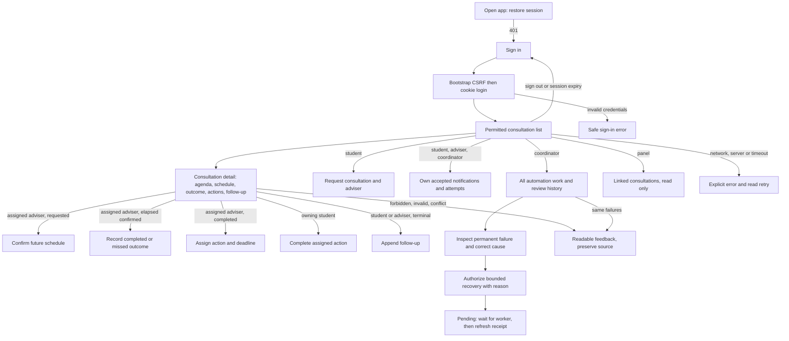

# Flutter Web workflow

Checkpoint 07, implemented 2026-10-29–30 Asia/Manila from student commit `297f266`. These screen/permission choices implement the bounded Project 29 design; they are not extra teacher-prescribed features. See [actual results and limitations](../evidence/test-results/FLUTTER-RESULTS.md).

## Screen flow



There are no hidden client roles, real messaging, external calendar integrations, edit/delete notes, reschedule/reopen features or future-week cryptography. Menus and buttons reflect known permissions, while Laravel independently authorizes every request. The ID lookup also allows a denied existing record to demonstrate that server boundary. Panel users have no automation navigation and no mutation buttons.

## Source guide and Flutter concepts

| File under frontend/lib | Purpose |
| --- | --- |
| main.dart | MaterialApp, restrained Material 3 theme and application entry |
| workspace.dart | StatefulWidget holding current user, navigation, paginated records, selected detail, loading and feedback; calls API and refreshes after confirmed writes |
| api.dart | One credentialed client, CSRF header, ten-second request limit, safe status/validation mapping; no automatic write retry |
| browser_transport*.dart | Web BrowserClient.withCredentials and URL-decoded public CSRF cookie; conditional stub permits non-browser test imports |
| ui.dart | Shared notices, sections, validated form dialog and Manila/UTC helpers |
| details.dart | Consultation controls and notification/attempt/recovery views |

A Widget describes visible UI. StatelessWidget is sufficient for a detail view whose data comes from its parent. StatefulWidget holds values that change, such as the signed-in user and loading flag. `setState` schedules a rebuild after those values change. `await` waits for an asynchronous HTTP operation without blocking the browser's UI; `mounted` guards prevent updating a disposed screen. `TextEditingController` reads form input and is disposed when its owner ends. `Form` validators give immediate feedback, then Laravel checks the same request authoritatively.

The editor disables Save/Cancel while writing, so it cannot silently queue repeated submissions. Network/timeout/5xx feedback treats a write result as uncertain: Save stays disabled, and the user closes the editor and refreshes the record before deciding whether to submit again. There is no blanket automatic retry. A ten-second Future timeout does not cancel a server transaction or prove that a write failed. Unknown HTTP diagnostics never become UI text; selected Laravel 422 field messages are displayed as plain text. A malformed success response is an explicit error. Full schema-corruption and arbitrary Unicode input testing are not claimed.

## Session and dates

On startup the app reads `/api/me`. A normal 401 shows sign-in. Sign-in first GETs `/sanctum/csrf-cookie`, then posts credentials with the URL-decoded XSRF-TOKEN in X-XSRF-TOKEN. BrowserClient includes cookies; the session cookie remains HttpOnly. No API key or demo password is compiled into Flutter, and no credential is saved in localStorage. Wrong credentials receive generic feedback and clear the password input. Sign-out uses the API and removes private screen data. An authentication/CSRF failure clears the UI's user/detail/list; the server remains the source of permission decisions.

Every schedule/deadline input is explicitly **YYYY-MM-DD HH:mm Manila**. Parsing validates the calendar, interprets the wall time as UTC+8 independently of the computer's timezone, then sends exact `YYYY-MM-DDTHH:mm:ssZ`. End must follow start and chosen times must be future. Example actually verified: 2026-10-30 09:00–09:30 Manila persisted as 01:00–01:30 UTC. Display converts UTC back to Manila. Server time/validation remain authoritative. The UI shows overdue action labels, inferred-missed limitations, first-scan dated summary counts, recipient/review ownership, cycles/attempts, receipt and safe attempt/recovery history.

## Run and verify

Use the existing installed tools/private configuration. Do not provision/reset the app or overwrite `.env`. Inspect active processes first; start missing services only. API runs from backend/public, MariaDB on loopback 3306, controlled receiver on 8090 as documented in [delivery setup](DELIVERY.md).

```powershell
Set-Location 'C:\Users\Laure\Documents\ChatGPT\IPT\week-13\frontend'
flutter pub get --offline
flutter analyze
flutter build web --dart-define=API_BASE_URL=http://127.0.0.1:8000/api
php -S 127.0.0.1:8080 -t build/web
```

Open http://127.0.0.1:8080. Use a fictional account such as student.one@example.test, adviser.one@example.test, panel.one@example.test or coordinator.one@example.test and the existing private DEMO_PASSWORD from backend/.env. Do not publish or screenshot that value. No signup screen is part of this bounded project. The six fictional accounts and roles were seeded earlier; testing does not impersonate actual people or claim their approval.

Only the public API base URL is compile-time configuration. `web` 1.1.2 was already installed transitively; declaring it directly makes the cookie import explicit. No dependency upgrade, SDK/security repair or new server framework was introduced. Laravel's exact credentialed CORS origin is 127.0.0.1:8080; using localhost or another port is not the same origin.

The release build and analysis passed. Five meaningful API/date/widget tests replace obsolete foundation tests, but the browser runner stalled at loading for more than twelve minutes and executed zero tests. Its process and temporary-profile descendants were stopped; output is retained. Earlier VM test policy blocker remains unresolved. Do not label either automated Flutter test path as passing. A successful compile and the separate actual browser exercises do not erase this gap.

## Controlled browser exercise

Actual browser tests created consultation16 and confirmed it for Oct30 09:00–09:30. The retained fictional elapsed consultation7 was later completed through the adviser UI, received action4 due Oct31 17:00 and a follow-up; the owning student completed action4. No clock or old record history was reset. This demonstrates workflow segments using disclosed controlled data, not a real meeting or an accelerated future consultation.

`tools/prepare-ui-recovery.php 16 prepare` ran once, using the real scanner and authenticated receiver's permanent fault mode; new work19 failed422. `fix` corrected only that receiver mode before the coordinator authorized recovery through Flutter. The bounded CLI worker then delivered only work19; the UI refreshed the receipt and old failure/recovery history. Original exhausted work15 remains unchanged. Four new scan rows included two new-day summaries at the Manila midnight rollover; three are still pending, not delivered.

For actual network error the verified local API alone was stopped. For loading/503/timeout evidence, `tools/ui-failure-router.php` temporarily occupied its loopback port with read-only safe responses: mode slow delayed3s then503, timeout delayed12s. It never loaded Laravel, accessed a DB, accepted a write or logged bodies. These are explicit controlled HTTP stand-ins, not fabricated Laravel database faults. The actual Laravel API was restored and a normal read verified afterward. No failure router remains running. Keep it out of routine startup instructions; it exists only for a deliberate isolated demonstration with no writes in flight.

## Usability and limits

Actual captures cover desktop1280x900, narrow390x844 and tablet768x1024. Scrolling is intentional for long records; notices, long receipts and correlations wrap. Navigation/buttons wrap at narrow widths. The forms are scrollable dialogs, inputs have labels, password is obscured, notices use live-region semantics, loading has a semantics label and disabled controls, and status is expressed in words. Tab moved from ID input to Open ID and Enter opened the record. Enable Flutter accessibility through its normal browser accessibility button when a screen reader/automation requires semantics. No full assistive-technology, focus-trap or contrast certification is claimed.

Browser automation initially failed to change some Flutter fields using AX setValue/rapid unfocused fills. It was corrected by focusing fields and using input events with state checks, including checking the actual signed-in role. No unauthorized write resulted. An initial tablet screenshot was captured before the layout settled and is retained separately; the final tablet summary capture is the layout evidence.

Not yet verified: real browser419/session expiry, every server422 mapping and every form at all viewport sizes, actual competing worker/process kill, continuous scheduler endurance or real messaging/read acknowledgment. Activities/SA7/lab report, maintainability evaluation, student reflection/AI acknowledgment, understanding/defense and actual submission remain pending.


## Checkpoint08 update — 2026-10-30

The recovery form now displays a maintainer warning if the API returns log_status unavailable. Latest analysis/build pass; API fault regression64 tests/325 assertions. The new warning branch was not exercised in a real browser; browser connector reload was unavailable during final checking. Earlier19 browser checks remain historical. Automated Flutter tests still unfinished.
