# User manual

Thesis Consultation Reminder System — Project 29, Week 13. This manual describes the implemented Flutter Web application, not proposed Week 14 security features. Open **http://127.0.0.1:8080/** after the maintainer starts the documented local services. Use fictional, assigned accounts only.

**Version:** proposed `week-13` submission, based on runtime commit `cfbacefdef66950d2a2fd71c705258d0099f2e9c` plus this documentation/evidence revision. The tag has not been created. Runtime source and compiled web SHA256 fingerprints match checkpoint08; see [revision verification](REVISION-VERIFICATION.md). A later documentation commit/tag identifies this manual; it does not change the dates of screenshots.

New captures in `evidence/screenshots/application/manual/` are from the 30 October revision smoke check. Other embedded images are genuine historical Week13 browser captures from 29–30 October, linked to [their original case records](../evidence/test-results/FLUTTER-RESULTS.md). Every major procedure below has an actual application screenshot; historical saved outcomes are not described as newly submitted actions. The new check did not create/confirm/close a consultation, add/complete an action, add a follow-up, scan, deliver or recover work. The read-only before/after snapshot and retained-effect verification are linked in the revision record.

## Contents and permitted roles

| Procedure | Role | Visible outcome |
| --- | --- | --- |
| [1 Sign in](#1-sign-in) / [2 Sign out](#2-sign-out) | All assigned roles | Account role and permitted navigation; session closed |
| [3 Find a consultation](#3-find-a-consultation) | Student, assigned adviser, linked panel, coordinator | Authorized list/detail and agenda |
| [4 Request a consultation](#4-request-a-consultation) | Student | Requested record awaiting adviser confirmation |
| [5 Confirm a schedule](#5-confirm-a-schedule) | Assigned adviser | Future confirmed interval in Manila time |
| [6 Record a meeting outcome](#6-record-a-meeting-outcome) | Assigned adviser | Completed or missed after the scheduled end |
| [7 Assign an action](#7-assign-an-action-item) | Assigned adviser | Open action with a future deadline |
| [8 Complete an action](#8-complete-an-action-item) | Owning student | Completion time retained |
| [9 Add follow-up](#9-add-a-follow-up) | Owning student / assigned adviser | Attributed note after terminal meeting outcome |
| [10 Panel review](#10-panel-review) | Explicitly linked panel | Read-only consultation/progress |
| [11 Notifications](#11-read-accepted-notifications) | Student, adviser, coordinator | Own accepted work and attempt history |
| [12 Reminders](#12-review-a-consultation-reminder) | Recipient; coordinator review | Scheduled consultation reminder and receipt |
| [13 Missed sessions](#13-review-missed-session-handling) | Recipient; coordinator review | Explicit inference requiring human review |
| [14 Deadlines](#14-review-an-action-item-deadline-notice) | Recipient; coordinator review | Overdue-action notice linked to its source |
| [15 Progress summaries](#15-read-a-progress-summary) | Adviser recipient; coordinator review | Dated first-scan Manila-day counts |
| [16 Failure review/recovery](#16-review-a-failure-and-authorize-recovery) | Coordinator | Cause/reason/history and bounded new cycle |
| [17 Safe errors](#17-handle-validation-permission-and-service-errors) | All | Actionable validation, denied access and retry guidance |
| [18 Small screens](#18-use-a-narrow-or-tablet-screen) | All | Wrapped controls and scrollable content |

Students see their own consultations; advisers see assigned consultations. Panel members only see explicitly linked consultations and cannot request, confirm, mutate actions/notes, access Notifications or recover work. Coordinators see consultation records and review automation failures but do not act as an assigned adviser or owning student. This matrix is an implementation choice, not a claimed complete university policy. Account creation, role assignment and panel linking are controlled setup tasks, not public UI functions. There is no registration, password-reset or profile-editor screen.

## Before using the application

1. Ask the maintainer for an assigned account and current local service address. No password is printed in this manual, screenshot or repository.
2. Use the same hostname consistently (`127.0.0.1` in Week13). Cookie sessions and the API must use the configured local origins. Keep normal browser cookie support enabled.
3. Read the role shown after sign-in. A role is decided by the server; entering another record ID does not grant access.
4. Use **YYYY-MM-DD HH:mm** for dates entered in forms. They mean Asia/Manila (UTC+8); Flutter sends UTC to the server. Example conversion only: `2026-11-01 09:00` means `2026-11-01T01:00:00Z`. Choose an actually future, available interval rather than replaying a date from an old screenshot.
5. Keep browser loading controls disabled until the response arrives. A receiver acceptance is not email/SMS delivery, attendance proof or a read acknowledgment.

For maintainer installation/startup, use [README](../README.md), [database setup](DATABASE.md), [delivery operations](DELIVERY.md) and the operator note below. Do not provision/reset an existing database or receiver ledger just to follow screenshots.

## 1 Sign in

**Role:** any assigned user. **Prerequisite:** API/database running and an existing account.

1. Open the application address.
2. Enter the assigned **Email** and **Password**.
3. Select **Sign in**, or press Enter from the password field.
4. Wait for the account name and role. Check the visible navigation before doing any work.

**Expected result:** only records allowed by the server are listed. An invalid email or empty password stays on the form; incorrect credentials produce safe rejection. The public client does not contain a shared service key.

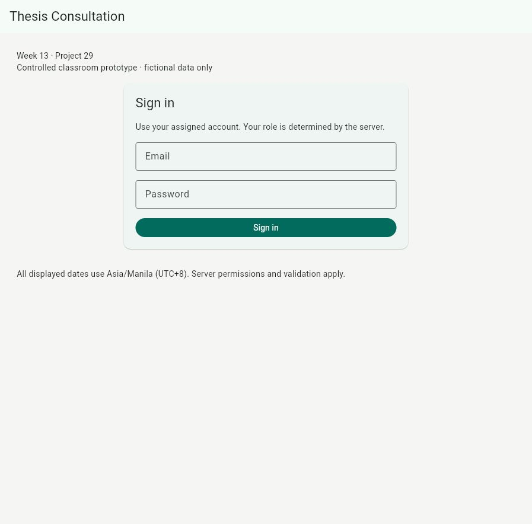

Revision capture: actual signed-out application. The account password was not captured.

## 2 Sign out

**Role:** any signed-in user.

1. Finish or cancel any open form.
2. Select **Sign out** at the top of the application.
3. Wait for **Signed out.** and the sign-in form before leaving a shared computer.

**Expected result:** the current server session is closed and protected navigation disappears. If a network error occurs, do not assume logout succeeded; restore connectivity and retry sign-out after inspecting the current state.

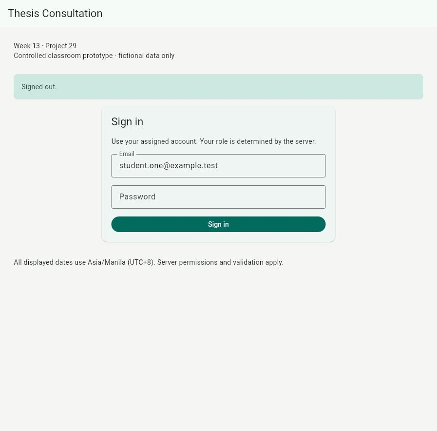

Revision capture: an actual logout, not a mock sign-in image.

## 3 Find a consultation

**Role:** student, assigned adviser, linked panel member or coordinator.

1. Select **Consultations**.
2. Use **Next** / **Previous** when enabled, or select a listed consultation.
3. To open a known record, replace the whole **Consultation ID** field with its positive numeric ID and select **Open ID**. A value from an earlier lookup may remain in the field.
4. Read the status, student/adviser, **Agenda**, dates, meeting notes, action items and follow-up. Use **Back to list** or **Refresh record** as needed.

**Expected result:** permitted detail is shown. A different student's existing record may return a safe permission error; an absent record returns not-found. ID numbers and counts in screenshots are fictional retained examples, not required data on another installation.

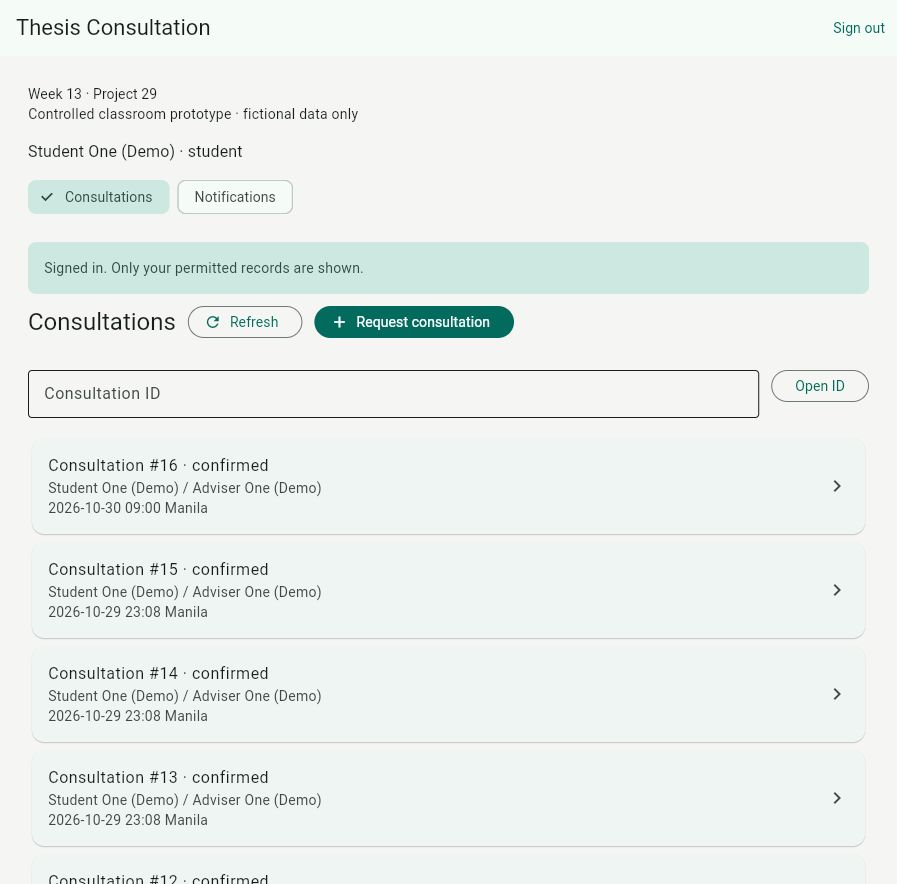

Revision capture: authorized student list. Dates displayed in this retained list can now be elapsed; they are not a new schedule confirmation.

## 4 Request a consultation

**Role:** student. **Prerequisite:** an assigned adviser appears in the controlled directory.

1. Select **Consultations**, then **Request consultation**.
2. Choose **Adviser**. The list identifies accounts; it does not promise actual adviser availability.
3. Enter an **Agenda** of 10–2000 characters using fictional or approved content.
4. Select **Save** once. Resolve field errors if shown, or select **Cancel** to leave without saving.
5. After success, open the returned/new list record and verify **requested** and the saved agenda.

**Expected result:** one request is saved and awaits assigned-adviser confirmation; requesting does not itself schedule or deliver a reminder. If the save response is uncertain, first refresh/read the list; this creation POST is not generally idempotent.

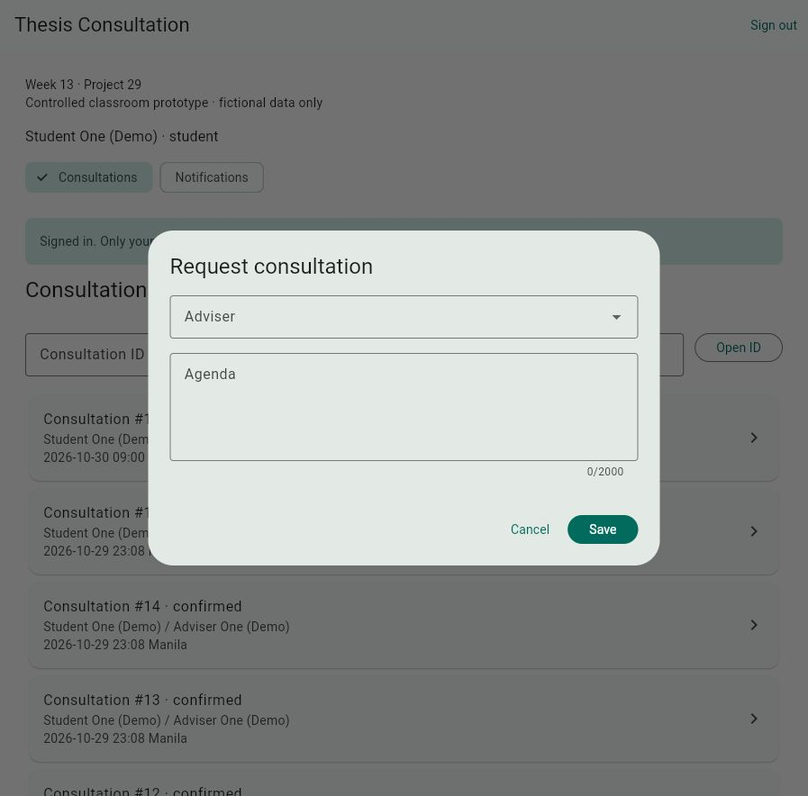

Revision capture: the actual form opened and cancelled without saving. [Historical request-created screenshot](../evidence/screenshots/application/w13-request-created.jpg) and WEB-04 document an earlier successful save.

## 5 Confirm a schedule

**Role:** the consultation's assigned adviser. **Prerequisite:** status is **requested**, not already confirmed.

1. Open the requested consultation and read its agenda.
2. Select **Confirm schedule**.
3. Enter **Start** and **End** in the form's Manila date/time format. Both must be future times; end must follow start.
4. Select **Save** once. If the adviser already has a recorded confirmed overlap, choose a different agreed interval after checking the record.
5. Verify **confirmed**, the displayed dates and schedule version on the detail screen.

**Expected result:** a confirmed schedule and audit event are recorded. This UI does not provide cancellation/rescheduling of already confirmed records or real calendar availability. The reminder is discovered by the separate automation scan.

Historical WEB-07: consultation16 was confirmed for30 October09:00–09:30 Manila during that earlier exercise. Do not reuse the now elapsed interval. The new check did not submit confirmation; automatic action review blocked opening this control, and this authentic earlier success is retained.

## 6 Record a meeting outcome

**Role:** assigned adviser. **Prerequisite:** status **confirmed** and the real scheduled end has passed.

1. Open the consultation and select **Refresh record** after the meeting ends.
2. Select **Record meeting outcome** when it becomes available.
3. Choose **Completed** or **Missed** based on the controlled actual scenario and enter **Meeting notes** (10–2000 characters).
4. Select **Save** once and verify the resulting terminal status and notes.

**Expected result:** the authorized outcome and audit are recorded. The button is unavailable before the scheduled end. Do not change the computer clock or mark a future meeting complete for demonstration. There is no correction/reopen endpoint; a disputed outcome requires maintainer/coordinator review and an agreed policy.

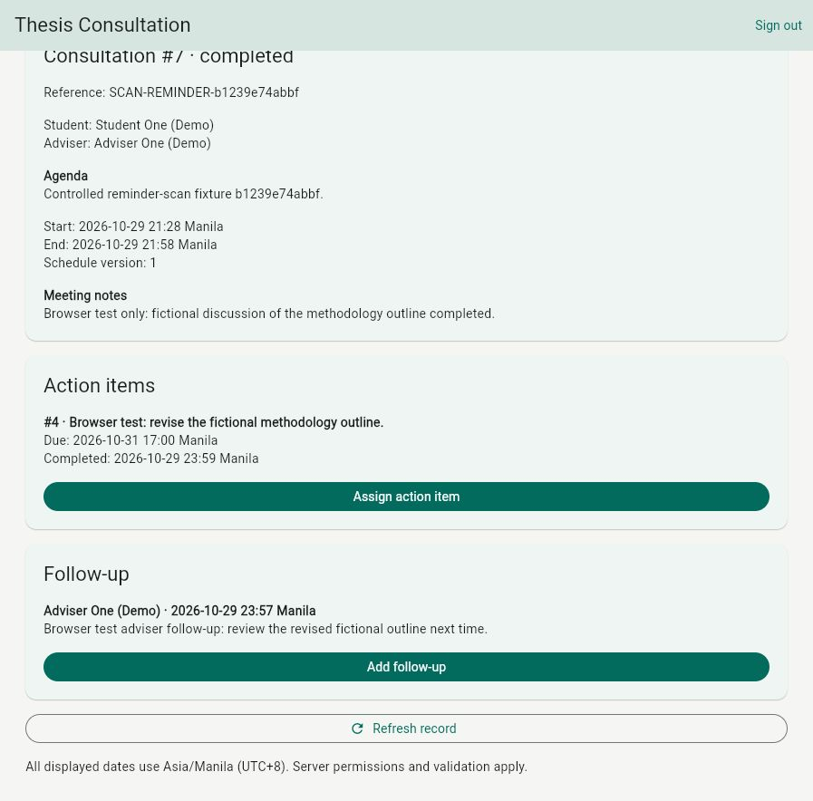

Revision read of consultation7: it already held the historical completed outcome. Its new read is not claimed as a new meeting or outcome write.

## 7 Assign an action item

**Role:** assigned adviser. **Prerequisite:** consultation **completed**.

1. Open the completed consultation and scroll to **Action items**.
2. Select **Assign action item**.
3. Enter **Action item** text of10–500 characters and a future **Due** date/time in Manila format.
4. Select **Save** once. Verify the text, deadline and **Open** status.

**Expected result:** the item is assigned to that consultation's owning student by the server. Users do not select arbitrary assignees. Assignment is not available for requested/confirmed/missed consultations. A deadline notice is a later automation result, not the same as assignment.

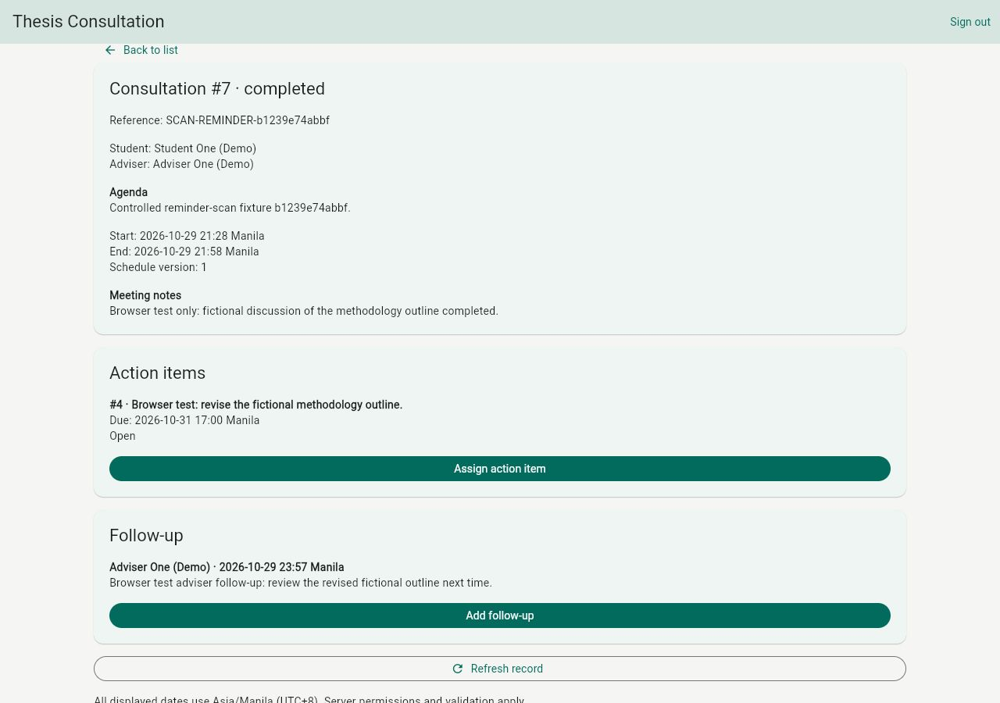

Historical WEB-08 shows actual saved action4 and follow-up4 on fictional completed7; source data was retained. Current revision reads the same record without adding another item.

## 8 Complete an action item

**Role:** owning student. **Prerequisite:** open item on a completed consultation.

1. Open your consultation and find **Action items**.
2. Read the action and due date. Finish the controlled task as appropriate.
3. Select **Complete action #ID** once for the intended item.
4. Wait for refresh and verify **Completed:** with its timestamp; the completion button is removed.

**Expected result:** the item remains in history as completed. Repeated authorized completion is idempotent; another student/adviser cannot complete it on the owner's behalf. An already queued obsolete deadline will be revalidated by the worker rather than blindly sent.

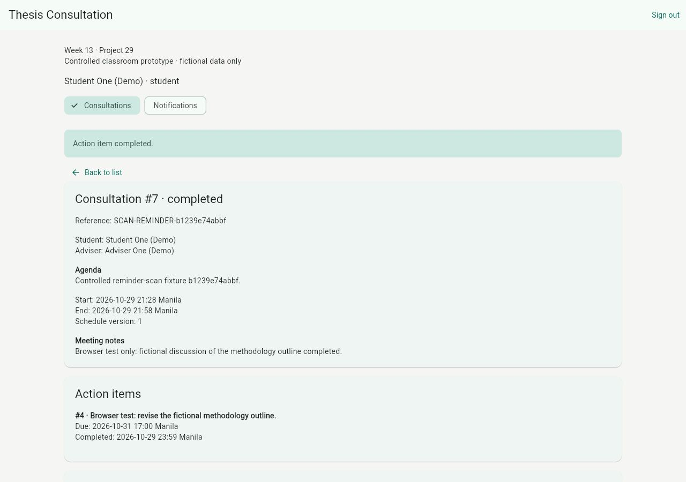

Historical WEB-09: owning student completed action4; the revision read confirms this retained state.

## 9 Add a follow-up

**Role:** owning student or assigned adviser. **Prerequisite:** consultation **completed** or **missed**.

1. Open the consultation and scroll to **Follow-up**.
2. Read existing dated/attributed notes to avoid repeating a response.
3. Select **Add follow-up**, enter **Follow-up message** text of10–2000 characters, then select **Save** once.
4. Verify the new note, author and displayed time after refresh.

**Expected result:** an attributed note and audit event are appended. A participant cannot choose another author's identity. This is not a chat/email service, and the creation POST is not generally idempotent after an uncertain response. Panel/coordinator reading a record does not grant participant-note creation.

Revision capture shows the real retained adviser note and action4 completion alongside the corresponding consultation.

## 10 Panel review

**Role:** panel member explicitly linked to a consultation.

1. Sign in with the panel account and select **Consultations**.
2. Open a linked record from the list or replace the ID field and use **Open ID**.
3. Review agenda, schedule, outcome, actions and follow-up. Use **Refresh record** for current data.
4. Sign out after reviewing.

**Expected result:** **Read-only consultation access.** is shown. No request, schedule/outcome, action completion, follow-up creation, Notifications or Automation review controls are supplied to panel users. An unlinked record is forbidden.

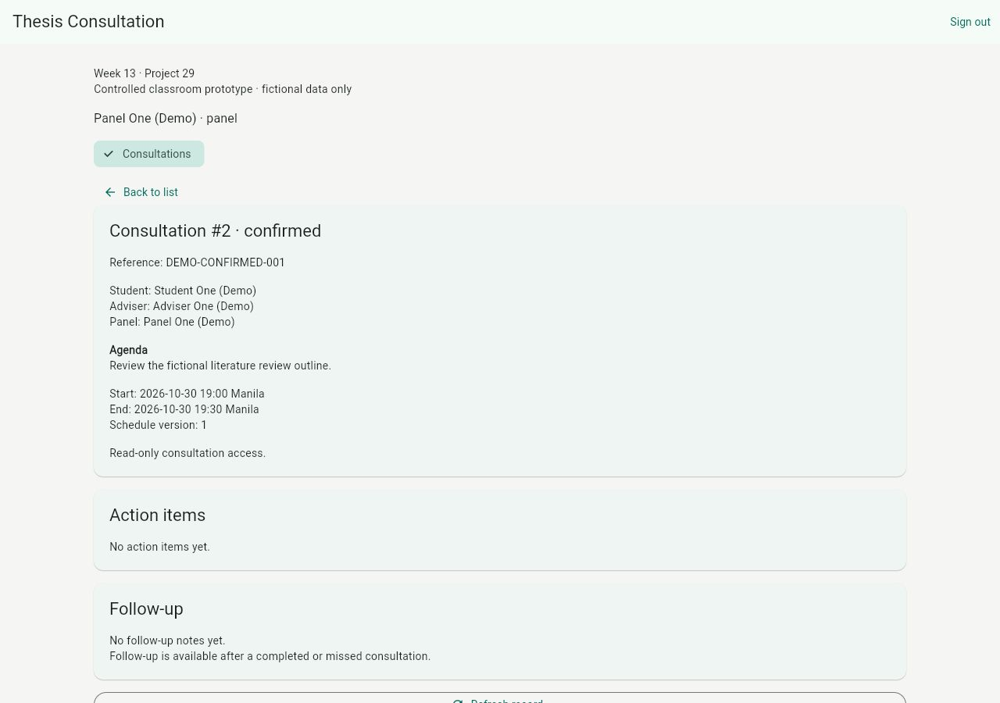

Historical WEB-14 on explicitly linked consultation2; permissions remain unchanged in the tested runtime.

## 11 Read accepted notifications

**Role:** student/adviser/coordinator for their own recipient notices. Panel has no Notifications area.

1. Select **Notifications**.
2. Read **Accepted notifications**, use pagination as needed and open a row.
3. Read the notice kind, source ID, scheduled time, correlation, accepted receipt and attempt history.
4. Use **Back to list** or **Refresh record** to return/update.

**Expected result:** only the current recipient's delivered/accepted work appears here. **Pending**, retrying and needs-review work is not an accepted notification; coordinators inspect those through Automation review. Delivered means receiver acceptance, not real email/SMS delivery or that anyone read it.

Historical WEB-06: delivered reminder17 retained its timeout followed by successful receipt reconciliation. This selected actual390px layout remains original evidence.

## 12 Review a consultation reminder

**Role:** recipient student/adviser; coordinator can inspect work through Automation review.

1. Use **Notifications** for your accepted reminders, or **Automation review** as coordinator for any status.
2. Open a **reminder** record and identify its consultation and scheduled start.
3. Read status and attempts; after a transient fault, compare the stable correlation and accepted receipt rather than assuming each retry is a new message.
4. Open the referenced consultation through **Consultations** and verify its current schedule.

**Expected result:** the scan discovers confirmed meetings starting in the next24 hours and creates work per recipient/version; the worker rechecks current eligibility. A receipt is historical acceptance. An elapsed/changed source can become obsolete; do not force old reminders to deliver.

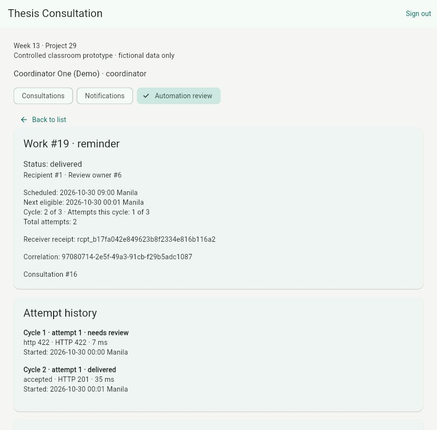

Revision read: work19 already had one422 failure, one authorized recovery and one accepted cycle2 receipt. [Historical recovered transient work13](../evidence/test-results/DELIVERY-RESULTS.md) separately proves the required transient retry path.

## 13 Review missed-session handling

**Role:** affected recipient; coordinator reviews exceptional/inferred states.

1. Open a **missed session** notice from Notifications or Automation review as permitted.
2. Read its source consultation, elapsed time and human-review explanation.
3. Check the current consultation and the responsible person's outcome information before drawing conclusions.
4. Ask the coordinator/maintainer to resolve a dispute using the documented policy process; do not invent an attendance decision or alter database rows manually.

**Expected result:** an elapsed confirmed consultation without a recorded outcome can be marked missed by the scan with an explicit automation audit. The notice requires human review. No absence penalty, real attendance proof or correction/reopen UI is implemented.

Historical WEB-13, work7/consultation8, shows the real human-review wording and accepted attempt.

## 14 Review an action-item deadline notice

**Role:** assigned student/adviser recipient; coordinator may inspect automation.

1. Open an **action deadline** notice from the appropriate area.
2. Read the **Consultation #** and **Action item #**.
3. Find that item in the source consultation and inspect current completion/deadline state.
4. Complete the action through procedure8 when appropriate, or discuss follow-up through procedure9. Do not treat a past notice as proof the item is still open now.

**Expected result:** the scan creates work for open overdue actions on completed meetings. Before sending, the worker rechecks status/deadline/version/recipient. It cancels obsolete pre-attempt work or routes an uncertain post-attempt change for review.

Historical WEB-13, work8/action3. Source/version validation and the normal scan/receiver cases are linked in the audit.

## 15 Read a progress summary

**Role:** adviser recipient for own summary; coordinator through Automation review.

1. Open a **progress summary** record.
2. Check adviser ID and **Manila snapshot** date.
3. Read requested, confirmed, completed, missed and open overdue action counts.
4. Check work status/attempt history separately from those counts. A pending snapshot has not been accepted by the receiver.

**Expected result:** one immutable first-scan snapshot per adviser/Manila day is retained, with adviser/coordinator recipient work. It is not a continuously recalculated dashboard, end-of-day report, grade or academic evaluation. No PDF/CSV export or summary-edit button is implemented.

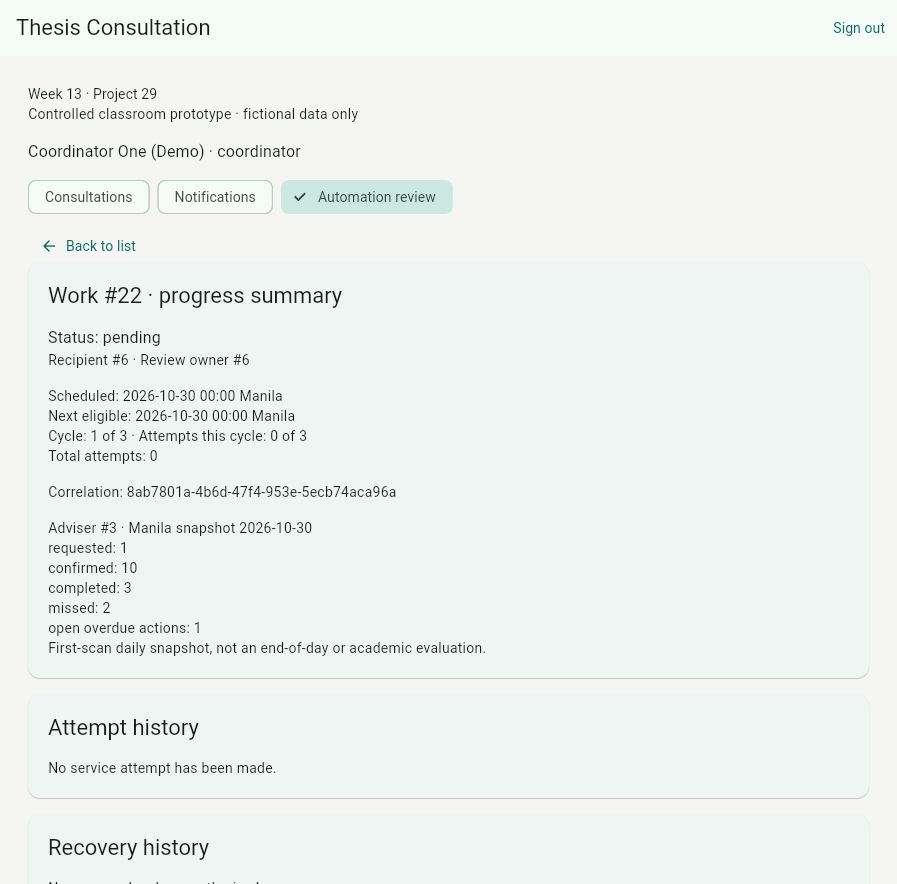

Revision read of work22: pending,0 attempts. Earlier accepted summary execution is in the delivery evidence; this image alone does not prove acceptance.

## 16 Review a failure and authorize recovery

**Role:** coordinator; maintainer resolves the service/source cause. **Prerequisite:** genuine needs-review work remains eligible, has no receipt and has not exhausted all3 cycles.

1. Select **Automation review** and inspect the kind/status. Replace the **Notification / work ID** field if opening a known item.
2. Open the work and read failure code, recipient/review owner, attempts and recovery history.
3. Diagnose the current source and dependency with the maintainer before using **Authorize recovery**. Do not retry a permanent cause that is still present or an elapsed reminder that is now obsolete.
4. Select **Authorize recovery**, enter **Diagnosis and recovery reason** (10–500 characters), and select **Save** once.
5. Verify **pending** and the next cycle. This queues existing work; the screen does not start a worker or guarantee delivery.
6. After the maintainer runs the bounded worker at the eligible time, refresh and inspect its result. Automatic attempts are capped at3/cycle, with30–35 then60–65 second eligibility delays; manual recovery allows at most3 cycles/9 reserved attempts total.
7. If operational logging is unavailable but recovery was queued, follow the warning: retain the DB audit, ask the maintainer to investigate and do not submit recovery again merely for a healthy log message.

**Expected result:** original identity, failure history and coordinator reason remain. Invalid reasons give validation; non-review/delivered/obsolete/cycle-limit recovery is rejected. A permanent4xx or exhausted transient failure stays assigned for human action, not endless retry.

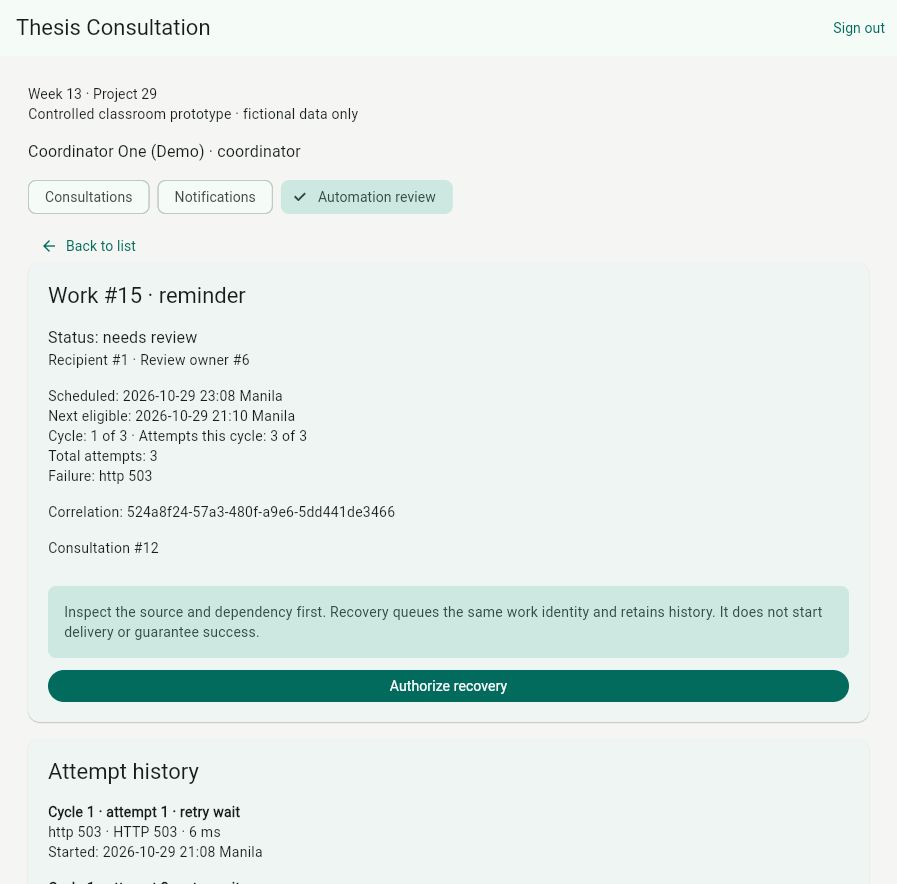

Revision read: work15 retains three503 attempts and needs_review, no new recovery. Its source is now elapsed; do not replay recovery from this screenshot.

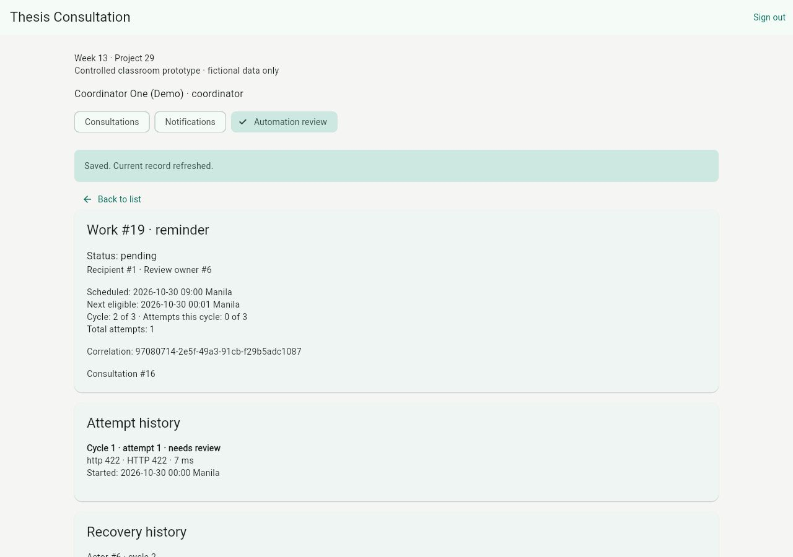

Historical WEB-11: coordinator corrected a controlled cause before queuing cycle2 of work19. The accepted-result screenshot in procedure12/read-only revision history and one-receipt DB evidence confirm that earlier exercise. The new log-outage warning has API injected-fault coverage; its real browser outage branch remains unverified.

## 17 Handle validation, permission and service errors

**Role:** all users.

1. Read field feedback; fix the specific format/required entry before another save. Use **Cancel** to leave a form without submitting.
2. For **You do not have permission...**, check the signed-in role and source assignment. Do not repeatedly guess IDs or change role fields in the client.
3. For **That record was not found...**, replace the complete ID field, then refresh the list to locate a real permitted record.
4. On expired/absent session, sign in again. For service unavailability/timeouts, ask the maintainer to restore the dependency and use Refresh for reads.
5. An uncertain write may already have committed: cancel/inspect the current record before resubmitting. The form disables automatic repeat after network/server uncertainty. Never infer success just because a button was clicked.

**Expected result:** safe feedback without SQL/key/password details; invalid/unauthorized requests do not authorize a mutation. The browser419 and actual ambiguous committed-write cases remain unverified; do not infer full coverage from these selected views.

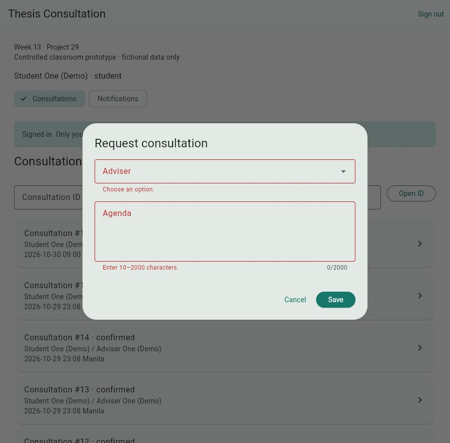

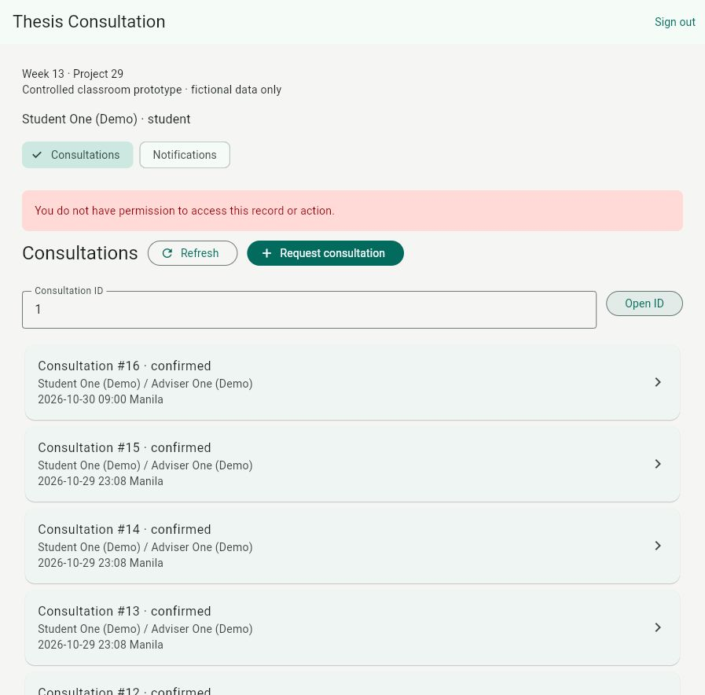

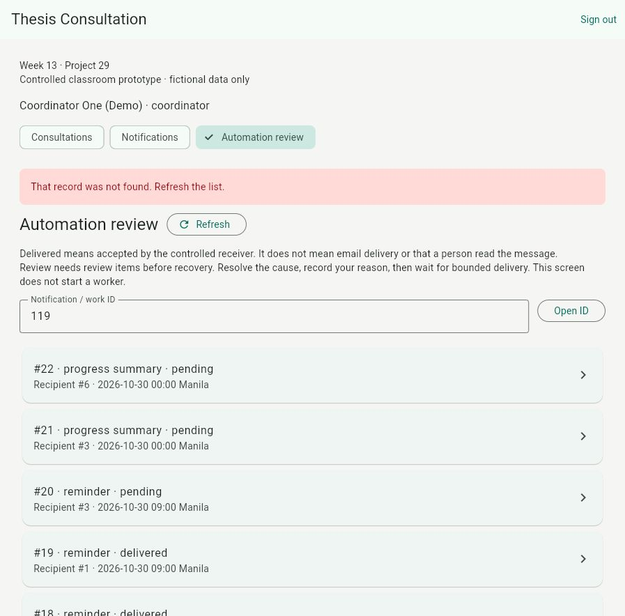

These are revision observations. Lookup119 arose from an unintended harness append to a retained ID, returned safe not-found, and was corrected by opening a real list row; no write occurred.

Historical WEB-17 used a temporary read-only503 stand-in; real Laravel was restored. Do not run the failure router as normal startup. No new outage was introduced for this manual.

## 18 Use a narrow or tablet screen

**Role:** all users.

1. Keep the same workflow and role checks. Scroll vertically to see longer record/history sections.
2. On narrow screens, navigation wraps; select the visible chip for the required area.
3. Scroll within a form to reach all fields/buttons. Check any inline validation before Save.
4. Use keyboard Tab/Enter where appropriate; exact focus order and full accessibility need further review beyond the selected checks.

**Expected result:** the bounded fields/history remain readable without treating the narrow layout as a separate mobile application. Android/iOS builds are not part of Week13.

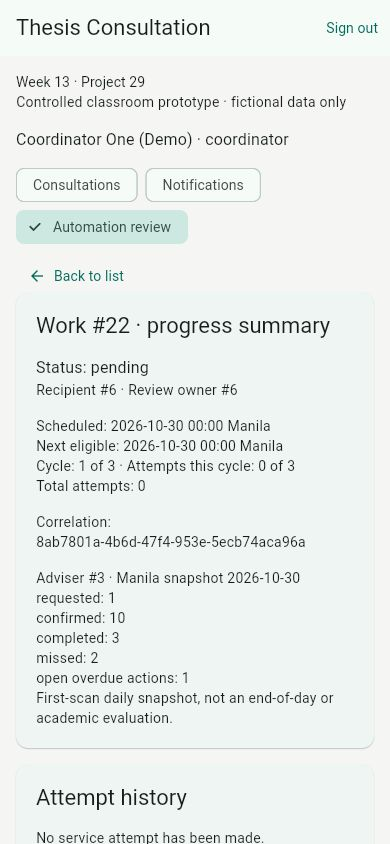

Viewport was reset after the new check. The historical file `w13-notification-history-tablet-768.jpg` was a premature resize and is deliberately not used as tablet proof.

## Operator note for automation and logs

These are maintainer procedures, not extra UI buttons. Read [delivery operations](DELIVERY.md) before running them. Existing private configuration and receiver SQLite ledger must be retained; `php tools/configure-notifications.php` is an initializer for a fresh authorized setup, not a routine start command.

1. Verify the existing database, API, static web server and receiver processes belong to this Week13 checkout before starting anything. Keep endpoints loopback-only. Week14 TLS/keys/ports are separate and are not started or changed by this manual revision.
2. Inspect current source/due work and review-owner assignment. A scan writes state, including inferred missed sessions; never run it merely to refresh evidence dates.
3. When due processing is intended, run `php artisan consultations:scan` from `backend/`; it validates bounded candidates and atomically writes work/audits. A repeat is duplicate-protected. More than100 candidates/category stops visibly rather than silently truncating.
4. Deliver only intended existing work with `php artisan automation:work --id=ID`; substitute a verified positive ID. Batch processing defaults to20 and caps at50. One bounded network attempt occurs per reserved attempt; wait for the recorded eligibility time before another retry.
5. Inspect command log_status, structured private `backend/storage/logs/automation.log`, and durable work/attempt/recovery history. Safe fields include correlation/work ID, kind, state, code, duration and cycle; do not publish private settings or raw diagnostics. See [sanitized structured log examples](../evidence/logs/automation-delivery.jsonl) and [real retry/recovery record](../evidence/test-results/DELIVERY-RESULTS.md).
6. Use the coordinator procedures for permanent/exhausted cases. Preserve failed records and receipt ledger; do not delete history or extend budgets to turn results green.

Both scan and worker are registered every minute with overlap protection, but **no persistent scheduler is running**. A schedule definition is not proof of unattended execution. The snapshots and UI actions do not start that scheduler. No production alerting, monitoring dashboard, real email/SMS or real attendance policy is claimed.

## Manual and evidence coverage

| Major function | Actual image(s) above | Evidence scope |
| --- | --- | --- |
| Sign-in/out and navigation | New sign-in, signed-out, student-list | New actual session and role checks |
| Request/agenda and validation | New request-form/validation; linked request-created | New form/invalid check, historical successful request |
| Schedule | schedule-confirmed | Historical actual confirmation, matching unchanged source |
| Meeting status | New completed-workflow | New read of retained executed outcome, historical WEB-08 mutation |
| Assign/complete action | adviser-outcome-action-followup; student-action-completed | Historical real mutations, new retained read |
| Follow-up | New completed-workflow | Actual retained note; prior API/browser audit |
| Panel read-only | panel-readonly | Historical actual role/view |
| Accepted notifications and reminders | narrow history; new recovered-history | Historical acceptance and new retained read |
| Missed sessions/deadlines | missed-session-notice; action-deadline-notice | Actual original notices and linked scan/API evidence |
| Progress summaries | New progress-summary/narrow; historical tablet | New dated read with honest pending state |
| Manual review/recovery | New exhausted-review/recovered-history; recovery-queued | New retained reads plus historical actual recovery |
| Errors and responsive feedback | New validation/forbidden/not-found/narrow; server503/tablet | Selected new/historical views, not exhaustive accessibility or performance proof |

Runtime controls are explained in [API contract](API-CONTRACT.md), [Flutter screen flow](FLUTTER.md), [automation design](AUTOMATION.md), [retry/recovery](DELIVERY.md), [five-topic decisions](DECISIONS.md) and [main report with both activities/SA7](WEEK-13-REPORT.md). The proposed [repository/tag transition](REPOSITORY-TRANSITION.md) preserves weekly versions. Personal reflection review, student understanding/defense, actual upload and instructor acceptance remain student/instructor actions; this manual does not certify them.
