# Week 13 Advanced Automation and Scripting Report

Revision30 October2026: Week13 runtime is committed as `cfbacef`; this working revision adds the [User Manual](USER-MANUAL.md), [one-repository transition](REPOSITORY-TRANSITION.md), fresh read-only UI captures and [revision verification](REVISION-VERIFICATION.md). The proposed weekly tag is `week-13`, not yet created. Earlier checkpoint-time counts/failed runs below remain historical; current regression64/325 and analysis pass are recorded separately. Week14 security work remains outside this version. Human reflection/defense/submission remain pending.

Project 29 Thesis Consultation Reminder System

PFEBSIT 002 Integrative Programming and Technologies 2 · SA7 and laboratory portfolio · 30 October 2026

## Scope and authority

The prototype supports consultation request, adviser confirmation, agenda, meeting outcome, action items and follow-up. Flutter Web calls an approved Laravel API backed by the student's XAMPP MariaDB environment. Four automations create reminders, infer missed sessions, identify overdue actions and prepare dated progress summaries. A separate local receiver accepts minimal notifications and returns receipts. Acceptance by this receiver does not mean email delivery or that someone read a message.

The student reports that the teacher assigned and approved Project 29. The official registry was not independently inspected or changed. The instructor is the acceptance authority for the assessed output. All operational identities and consultation records are fictional. No actual stakeholder acceptance, university attendance policy, adviser availability or production readiness is claimed. The deadline supplied by the student is 30 October 2026; the submission time is unconfirmed.

The work started fresh in week-13. Archived generic code, settings, credentials, evidence and Git history were excluded. The student committed and pushed checkpoints01–08; the verified runtime base is cfbacefdef66950d2a2fd71c705258d0099f2e9c. This manual/policy revision preserves that code and adds current documentation/evidence. Final documentation commits and the proposed weekly tag still require student review and execution.

## Workflow and ownership

The following permissions are design decisions for this bounded exercise, not a university policy supplied by the guide.

| Role | Permitted workflow and responsibility |
| --- | --- |
| Student | Request a consultation with agenda, view own records and notifications, complete own assigned actions and append follow-up after a terminal outcome |
| Assigned adviser | Confirm a future nonoverlapping recorded schedule, record an elapsed meeting outcome, assign action deadlines and append follow-up |
| Panel member | Read explicitly linked consultations and recorded progress; no mutation or automation recovery |
| Coordinator | Review all prototype records and automation failures; diagnose the cause and authorize bounded recovery with a reason |
| Student operator as maintainer | Run local services and intended bounded commands, inspect evidence and configuration, investigate outages; no authority to invent academic outcomes |

Browser evidence used request 16, confirmed for 30 October 09:00–09:30 Manila. It remained a future consultation during the exercise. A different retained fictional elapsed fixture, consultation 7, was completed through the adviser UI, received action 4 and follow-up 4, and the owning student completed action 4. This demonstrates controlled workflow segments without changing the computer clock or pretending the future meeting occurred.

## Architecture decision

Decision question: how can a small individual project demonstrate four time-dependent automations, recover from service faults and remain understandable without operating an additional broker?

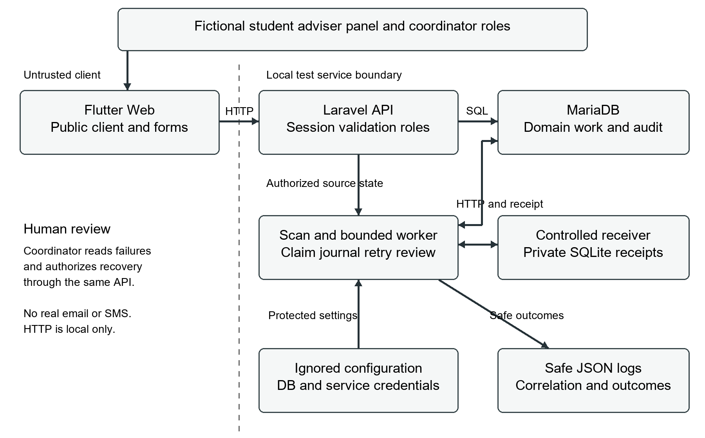

The selected design combines immediate authorized API transactions with minute-scheduled database discovery and a bounded delivery command. A request is a domain event, but no external event bus or webhook system is implemented. Domain changes and audit records share a transaction. Scan state, inferred-missed audit and durable notification work also commit together. The worker reserves a journaled attempt before calling the receiver outside the transaction.

| Criterion | Selected database scan and bounded worker | Event-only broker or webhook alternative |
| --- | --- | --- |
| Functional fit | Discovers future times, elapsed schedules and overdue records even after downtime | Fast on changes but still needs delayed scheduling and catch-up for time passage |
| Security | Scoped DB users and private loopback service key; no client secret | Additional broker credentials or inbound endpoint verification and ownership |
| Reliability | Unique work identity, lease, journal and receiver receipt must agree | Broker delivery, reconnect, ordering and duplicate-event controls also required |
| Performance | Minute-level discovery, bounded scans and 20-row worker batches | Lower change latency; benefit is unmeasured for this small fixture set |
| Effort and skills | Conventional Laravel commands, transactions and readable Flutter state | More components and operational failure modes for the student to explain |
| Ownership | Student operator runs services; fictional coordinator reviews exceptions | Requires an identified broker/webhook operator as well |
| Verification | Explicit commands, isolated tests and controlled receiver faults | Needs broker/event timing, authentication and redelivery evidence |

The cost is operator dependence and discovery delay. A schedule registration is not evidence that a persistent scheduler was running. The current evidence verifies an earlier scheduled scan and real bounded worker calls; combined continuous scheduling and endurance remain unverified. Review this choice if measured volume or required latency exceeds the tested arrangement.

## Trigger contract

All stored times are UTC. Flutter displays and parses Asia/Manila as UTC+8 independently of the computer timezone. The 24-hour reminder window, 100-candidate category cap, 20-item default worker batch and first-coordinator ownership are implementation choices.

| Automation | Eligibility and identity | Output and human boundary |
| --- | --- | --- |
| Reminder | Confirmed meeting starts in the future within 24 hours; kind plus meeting/version/recipient | Student and assigned-adviser work; adviser keeps schedule authority |
| Missed session | Confirmed end elapsed without a recorded outcome; kind plus meeting/version/recipient | Atomic inferred-missed state/audit and notices to student, adviser and coordinator; explicit human-review basis, no attendance proof or penalty |
| Action deadline | Open overdue action on a completed consultation; kind plus action/deadline-version/recipient | Student and adviser work; humans decide the follow-up |
| Progress summary | First scan of a Manila day for each adviser with consultations; adviser/date/recipient | Immutable dated counts for adviser and coordinator; not an end-of-day report or academic evaluation |

Each scan checks at most 100 eligible records per category with a lookahead. Excess capacity or missing review ownership stops visibly and rolls the scan back. This prevents silent partial work but can stop all categories; automatic pagination is not implemented. Work is ordered by ID, not by a global cross-category priority guarantee. A worker processes at most 20 due rows by default, accepts a configured limit up to 50 and exits. Overlap locks and row claims address duplicates; actual competing-process execution has not been measured.

## Execution and recovery

Before every service call, the worker revalidates source existence/state, schedule or deadline version, exact time, participant roles, recipient, minimal payload and derived identity. Obsolete work before a call is cancelled. A changed source after an attempt requires review because the receiver may already have accepted it. The receiver cannot retract an accepted notification.

A short row-lock transaction reserves a random 30-second claim token, increments counters and inserts a started attempt. One HTTP request then uses a two-second connection limit and five-second overall limit. A matching receipt permits delivered state. A late result cannot overwrite a newer claim. Expired claims retain interrupted history and can use only the remaining attempt budget.

| Failure class | Bounded decision |
| --- | --- |
| Invalid input or unauthorized API request | Safe 422/401/403 response; no authorized domain change |
| Invalid queued source or identity | No service call; needs_review with an explicit code |
| Connection failure, timeout, 429 or 5xx | Persist retry eligibility, then return; no nested HTTP retry |
| Other HTTP errors or malformed 2xx receipt | Immediate coordinator review |
| Three failed reserved attempts | Stop automatic calls and retain review ownership/history |
| Authorized manual recovery | Reason 10–500 characters; same identity; at most 3 total cycles and 9 reserved attempts |

Backoff is 30–35 seconds, then 60–65 seconds, including jitter. These are earliest eligible times, not guaranteed execution times. The receiver transaction stores identity, payload hash, receipt and acceptance time. The same identity and payload returns the original receipt; changed payload returns 409. Durable states act as processing checkpoints. The review state serves a dead-letter-like purpose, but no separate dead-letter queue or global circuit breaker is installed. Per-item limits do not stop other items calling a failed dependency. Compensation means human review of an uncertain accepted result here; there is no automatic remote undo.

## Security and protected configuration

The browser is an untrusted public client. Laravel's session, CSRF, role and record checks remain authoritative even when Flutter hides buttons. The session cookie is HttpOnly; only the public CSRF cookie supplies the write header. No private service key or demo password is compiled into Flutter or stored in localStorage. Local HTTP and non-Secure transport remain limitations for Week 14, not proof of HTTPS.

Protected examples are backend/.env.example, backend/.env.testing.example and notification-service/.env.example. Actual configuration files and the receiver ledger are ignored. App/test DB accounts are separate and tests validate the isolated connection before RefreshDatabase. Their current local migration/runtime privileges are not a production least-privilege split. Lockfiles are retained; no automatic dependency upgrade or credential rotation was performed. Rotation requires a deliberate coordinated update of both private service settings and a subsequent verification, not printing or committing the key.

Audit and structured operational logs use IDs, statuses, safe error codes, durations and correlations. They omit passwords, tokens, agendas and note bodies. Recovery reasons are retained in the authorized DB audit, not operational log text. An administrator with DB access could alter history; it is not a tamper-proof store. Exact private-value scans and actual screenshot review supplement ignore rules; no single pattern scan proves absence of every possible secret. See the final review and evidence index for the recorded scope.

## Activity 1 architecture decision

Three contrasting office workflows are selected within Project 29, so the activity does not introduce another submitted project. Assumptions are a small classroom workload, one student operating local processes, fictional coordinator/adviser roles and no production messaging service. The measured fixture set is small; its volume is not an institutional forecast. Dependencies are MariaDB, the API, the worker trigger and receiver. The instructor accepts the assessed result; no operational acceptance has been obtained from real office staff.

| Workflow | Selected pattern | Feasible alternative and reason not selected |
| --- | --- | --- |
| Consultation request and adviser decision | User-triggered API transaction with immediate validated UI result and audit | Nightly CSV/batch approval import: feasible with exports, but delays interactive feedback and adds import reconciliation; no need for it in this test workflow |
| Reminder, missed-session and overdue-action discovery | Minute schedule plus durable DB work and bounded service execution | Domain events alone: quick on edits, but the clock can make a record due without another edit; delayed jobs plus catch-up would add state and operation |
| Daily adviser progress summary | Manila-day scan with immutable first-scan snapshot and unique adviser/date identity | Recompute on every change or continuous stream: fresher counters, but more event coordination and a different reporting contract than the chosen snapshot |

Interactive latency is bounded by client feedback/error limits; real response targets beyond the recorded checks are not measured. Time-based work accepts scan delay and can catch up after downtime. Daily summaries prioritize a stable reproducible date over instantaneous totals. Bounded volume checks and finite calls apply to all choices. Private configuration and server approval checks are required regardless of the trigger. Staffing remains a disadvantage: the operator must run processes and the coordinator must inspect failures.

Adverse case: another student requesting consultation 1 receives forbidden feedback and no detail; invalid schedule order is rejected. A repeated scan creates no second work identity. These cases connect trigger choice to permission and duplicate boundaries rather than assuming that a successful button click establishes reliability. Relevant source/configuration: routes/console.php, ConsultationController, AutomationScanner and the example environments. Evidence: API-RESULTS, SCAN-RESULTS, FLUTTER-RESULTS and the corresponding saved requests/logs. Routine reproduction uses the guarded test suite; do not regenerate old live fixtures just to change timestamps.

The selected design remains appropriate only within this bounded evidence. The next improvement is measured queue-age monitoring and a real operational schedule exercise before claiming unattended execution. A broker is reconsidered only when measured latency, volume or ownership needs justify it.

## Activity 1 interpretation

### Observed facts

The consultation API records authorized changes immediately, whereas time passage is discovered by a scheduled scan. The retained first and repeat scans produced 11 and 0 new work rows. Real browser checks showed a student request, assigned-adviser confirmation and denial of another student's record. A new scan across Manila midnight created dated progress-summary records. The project uses no broker, webhook endpoint or production messaging provider. The tested dataset and 100-record category cap are disclosed.

### Reasoned conclusions

These observations support using different triggers for interactive decisions, elapsed deadlines and daily reporting. A domain event alone cannot notice an unchanged record becoming overdue. A database scan can revisit it after downtime, while unique identities prevent the same scan window producing duplicate work. The synchronous API gives the user a decision promptly without moving approval authority into Flutter. A daily snapshot has a stable meaning but becomes stale as later changes occur. None of these findings proves a one-minute service level or sustainable load capacity.

### Recommendations

Keep the selected hybrid for this classroom prototype, retain server authorization and review ownership, and document the costs of running the processes. Before broader use, measure oldest-due age and run the combined scheduler under a representative controlled workload. Establish a correction policy for inferred missed sessions. Only introduce a broker if measured needs justify its credentials, delayed-job controls and operator responsibilities. The instructor must judge the activity evidence; this interpretation does not claim actual institutional acceptance. Reflection on personal understanding is supplied separately by the student.

## Activity 2 failure verification

The acceptance criteria were one logical receiver acceptance for a repeated identity, no fourth automatic attempt after exhaustion, retained failed work/history and an authorized review path. Existing real-service exercises predicted temporary 503/timeout recovery, permanent 422 review and same-receipt reconciliation after lost acknowledgment. All use fictional records and a controlled receiver. A manually initialized accepted-but-unrecorded claim tests the interruption boundary; it is not evidence of an actual killed process.

| Controlled case | Retained observed result |
| --- | --- |
| Temporary 503 work 13 | retry_wait then delivered on attempt 2 |
| Permanent 422 work 14 | needs_review, coordinator recovery, delivered in cycle 2 with prior failure retained |
| Persistent 503 work 15 | Three attempts, needs_review, no receipt and no fourth call |
| Lost acknowledgment work 16 | Receiver accepted before 503; retry returned same receipt, one ledger row |
| Five-second timeout work 17 | Recorded 5019 ms timeout; retry returned prior receipt, one ledger row |
| Interrupted boundary work 18 | Active lease skipped; expired lease journals interrupted, next attempt reconciles the receipt |
| UI recovery work 19 | Actual coordinator reason/actor/cycle preserved; one accepted receipt after controlled 422 cause corrected |

The new improvement targets a documented observability gap, not a fabricated lost record. Before changing code, a controlled test made the logging facade throw after recovery committed. The prediction was that the DB audit would remain but the API would omit log_status. The retained baseline passed its persistence assertions and failed its last assertion because log_status was null. No app record or OS logging permission was changed.

The controller now returns log_status=recorded or unavailable with HTTP 200 because the recovery transaction already succeeded. Flutter preserves the successful queued outcome and tells the maintainer to investigate unavailable logging without repeating recovery. The same controlled test passes all 10 assertions after the change; full isolated regression passes 64 tests/325 assertions. Analysis is clean and the updated web build passes. Normal recovery is also checked for log_status=recorded. The browser warning branch for a real filesystem logging outage is not executed; its code compiles, and the API failure branch is tested with an injected logger fault.

Two approaches were considered: signal recovery failure and invite retry, or keep the committed result and expose a separate telemetry status. The second is selected because it distinguishes durable business state from an unavailable log. It adds a field and a client message, not another retry layer. A continued log outage still needs the maintainer; the coordinator's DB history remains inspectable. Source changes affect AutomationController, its feature test and one Flutter edit-result function; no schema or dependency change is required.

Evidence: activity2-log-outage-before-audit-verified.txt, activity2-log-outage-after.txt, final-backend-regression.txt, final-flutter-analyze.txt and final-flutter-build.txt. Existing real-service records are indexed in DELIVERY-RESULTS and FLUTTER-RESULTS. Run php artisan test --filter=recovery_reports_log_outage to repeat the new fault safely in the isolated test database. Full regression remains required after further source changes.

## Activity 2 interpretation

### Observed facts

The seven deliberately faulted delivery fixtures retained 14 attempt journal entries. Six cases eventually had one accepted receiver receipt; persistent unavailability had none and remained assigned for review. A repeat did not create a fourth call for that exhausted item. The interrupted boundary retained its prior journal entry. The new logger-failure test demonstrated a different problem: recovery and its audit were durable, but the successful API response originally omitted the telemetry outage. That predicted final assertion failed before the change and passed afterward, along with the full backend regression.

### Reasoned conclusions

Within this controlled receiver and retained ledger, stable identities and receipt reconciliation prevent duplicate acceptance across the exercised retries. Finite attempt/cycle budgets prevent endless processing of one work item. Durable review ownership makes unresolved failure visible rather than deleting it. These are bounded findings, not guarantees against disk loss, ledger deletion or every competing-process race. The logger test also shows why a committed recovery and its operational logging must be reported separately: an unavailable log does not mean the coordinator's transaction failed.

### Recommendations

Keep immutable work identities, finite leases and preserved failure history. Use the explicit log status to request maintainer investigation while inspecting the DB audit; do not repeat recovery merely to obtain a green log result. Next test a real controlled competing-worker/interruption exercise and a protected ledger backup/restore before broader use. Measure queue age during sustained dependency failure and decide whether a global circuit breaker is warranted. The fault-heavy sample must not become a claimed production reliability percentage. The instructor remains the assessment acceptance authority; student understanding and personal reflection are not established by these automated records.

## Reliability and maintainability evaluation

The read-only summarizer derives indicators from retained JSON rather than rerunning or altering live records. In the seven-case fault cohort, 14 journal entries include one interrupted boundary and 13 recorded worker HTTP attempts. Six HTTP errors and one timeout give a 53.85% failed-attempt rate in this deliberately adverse sample. Six of seven cases ultimately accepted a receipt, 85.71%; the seventh remains reviewable. These percentages describe this test mix, not normal-use reliability.

Recorded HTTP durations have 13 samples: mean 397.31 ms, median 6 ms and maximum 5019 ms. The 134-second exercise interval includes waits and manual intervention; six acceptances in that interval are 2.687 per minute. That is an observed exercise rate, not sustainable throughput or an SLA. No CPU, memory, peak load or concurrent-worker measurements were taken. The historical queue snapshot at 2026-10-29T16:09:35Z contains 22 work rows:18 accepted, 3 pending and 1 needs_review. It is not a current live queue measurement. A pending record is not a lost record or a delivered message.

| Maintainability indicator | Evidence and implication |
| --- | --- |
| Focused backend responsibilities | Scanner 165 physical lines, eligibility 105 and delivery 134 at capture; HTTP is outside discovery/claim transactions |
| Growing client state | workspace.dart 549 physical lines; explicit state is understandable, but screen extraction is warranted if changes become harder to test |
| Change impact | Logging-feedback improvement changes one controller, one backend test and one Flutter function; additive API field, no migrations/packages |
| Reproducibility | Lockfiles, ten migrations, fictional seeders, guarded test schema, examples, setup/runbook and descriptive evidence paths |
| Operational ownership | Student operator maintains local services; coordinator review requires an actual operator in broader use |
| Verification limits |64 backend tests pass; automated Flutter runner stalled with zero executed; selected browser checks do not erase that gap |

Line counts are navigation/change indicators, not proof of quality. The first maintenance priority is reproducible Flutter automated execution in a suitable approved environment, followed by deliberate continuous-scheduler and queue-age checks. Do not disable security controls automatically. A later maintainer must also split migration/runtime privileges, verify protected ledger recovery and agree how to correct an inferred missed outcome. Those work items remain unverified, not silently exempted.

## Evidence and assessment mapping

| Assessment component | Evidence supplied and remaining human work |
| --- | --- |
| Concept check 15% | Architecture/trigger alternatives, control explanations and two interpretations; actual quiz/grade not claimed |
| Guided build 35% | Flutter/API source, configuration examples, migrations/seeders, validated roles/workflow and indexed screenshots |
| Adverse test 25% | Retained service faults, no-fourth-attempt and single-receipt evidence; new predicted logger failure, improvement and regression |
| Technical portfolio 25% | Report, diagrams, decision/runbook, tests, metrics, limits and demo/backup guide; viva and student understanding pending |

The repository evidence index links foundation, data, API, workflow, scan, delivery and Flutter result maps. New summary indicators are reproducible with php tools/summarize-evidence.php. Actual source screenshots were captured from saved VS Code files; actual UI screenshots came from the running Flutter build. Conceptual diagrams are labeled design artifacts, not execution evidence. Failed and blocked runs remain alongside retests. The student's personal reflection is a separate local Word document and is not GitHub content.

## Limits and recommendation

The bounded prototype is suitable for a controlled classroom review with its preserved evidence and fallback path. It is not approved for production, academic penalties or real notifications. Automated Flutter tests, real browser 419/session expiry, full accessibility/viewport coverage, combined continuous scheduling, competing processes, ledger restore and broader performance remain unverified. No HTTPS/authenticated-encryption, UAT, examination or future-week completion is claimed.

Source/doc preparation does not complete the student's own review, reflection, AI acknowledgment confirmation, final commit/push, defense or actual submission. Instructor evaluation and any decision about the recorded test limitation remain external. Submission is conditional on those student/instructor actions; the checklist must not be marked fully complete merely because this report exists.

## References and AI assistance

Assignment authorities are the local PFEBSIT_002_Weeks_13-18_Student_Module_Flutter_Web.docx, full Module 13, and 35_Project_Options_Weeks_13_18_Individual_Student_Project_Guide.docx, common rules/assessment mapping/Project 29. The generic professional scenario is adapted only to the user's reported assigned option. The module's listed secondary article was not independently consulted and is not represented as a read source.

Official documentation checked 30 October 2026: Laravel 12 Task Scheduling and HTTP Client, Microsoft Azure Retry and Circuit Breaker patterns. Laravel/framework and Sanctum behavior was also inspected in the installed code. Flutter/http/web dependency versions are recorded in the lockfiles and actual tool output. URLs: https://laravel.com/docs/12.x/scheduling ; https://laravel.com/docs/12.x/http-client ; https://laravel.com/docs/12.x/sanctum ; https://docs.flutter.dev/platform-integration/web ; https://pub.dev/documentation/http/1.6.0/browser_client/BrowserClient-class.html ; https://learn.microsoft.com/azure/architecture/patterns/retry ; https://learn.microsoft.com/azure/architecture/patterns/circuit-breaker . No lengthy source text is reproduced.

AI assistance disclosure for student review: Codex assisted with requirements extraction, design, implementation, tests, evidence capture, failure analysis and technical documentation in this individual workspace. Framework/scaffold and library code is third-party code. The student performed the recorded commits/pushes and must personally review, reproduce, understand and defend the submitted work under institutional policy. No claim is made that the student independently authored all generated code or has already demonstrated understanding. The student must confirm the disclosure and review and revise the separate AI-assisted reflection draft in their own words before submission.

## Evidence capture 1 Source code and recovery log status

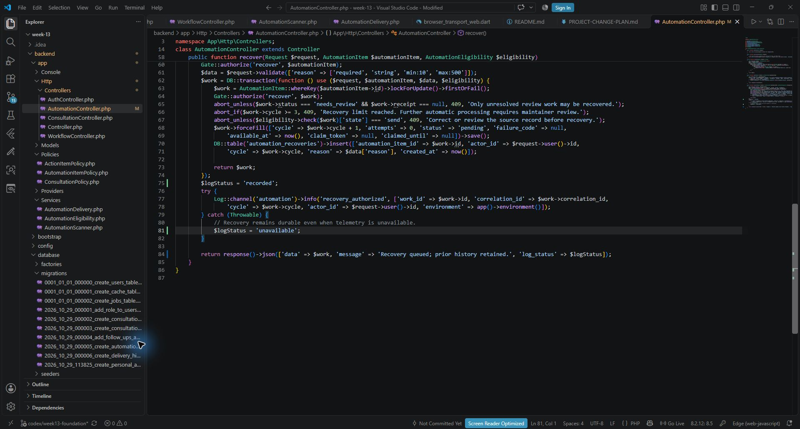

Actual saved AutomationController.php in VS Code with filename and line numbers. Shows the separate log_status response after durable recovery. Source evidence only; API injected-fault results prove execution, and the new warning has not been browser-executed.

Source image: evidence/screenshots/source-code/w13-recovery-log-status-vscode.jpg. Historical browser captures belong to checkpoint07; the source capture is checkpoint08.

## Evidence capture 2 Consultation schedule confirmation

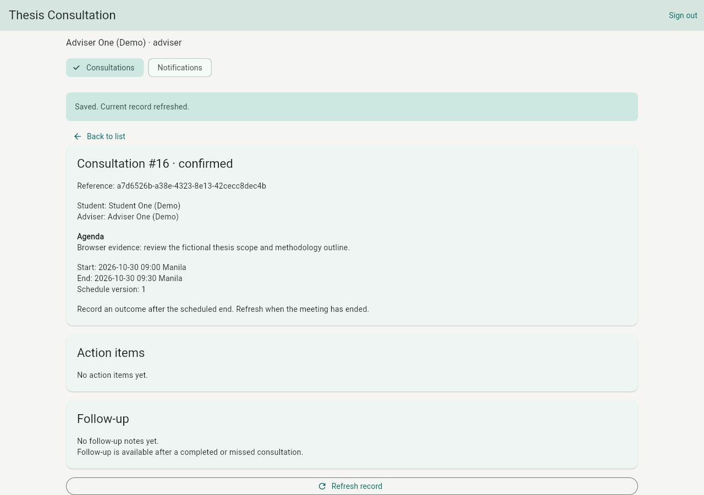

WEB-07. The assigned adviser confirmed request16 for30 October09:00–09:30 Manila. The exercise did not claim that this future meeting had occurred. Persisted-effect evidence is indexed in FLUTTER-RESULTS.md.

Source image: evidence/screenshots/application/w13-schedule-confirmed.jpg. Historical browser captures belong to checkpoint07; the source capture is checkpoint08.

## Evidence capture 3 Required request input validation

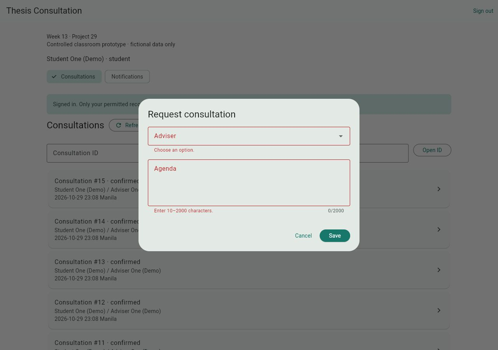

WEB-04. Actual Flutter request form rejects missing adviser or agenda before saving. This selected client check accompanies authoritative server validation; it does not cover every invalid input.

Source image: evidence/screenshots/application/w13-request-validation.jpg. Historical browser captures belong to checkpoint07; the source capture is checkpoint08.

## Evidence capture 4 Unauthorized record access

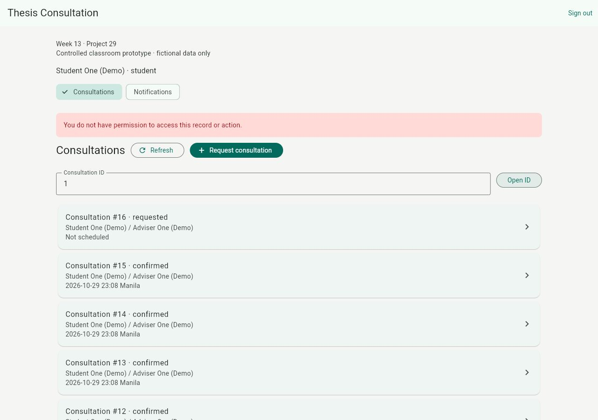

WEB-05. Student access to another student’s consultation1 is denied without private detail. Server policy tests provide additional authorization evidence.

Source image: evidence/screenshots/application/w13-forbidden-record.jpg. Historical browser captures belong to checkpoint07; the source capture is checkpoint08.

## Evidence capture 5 Permanent failure routed for human review

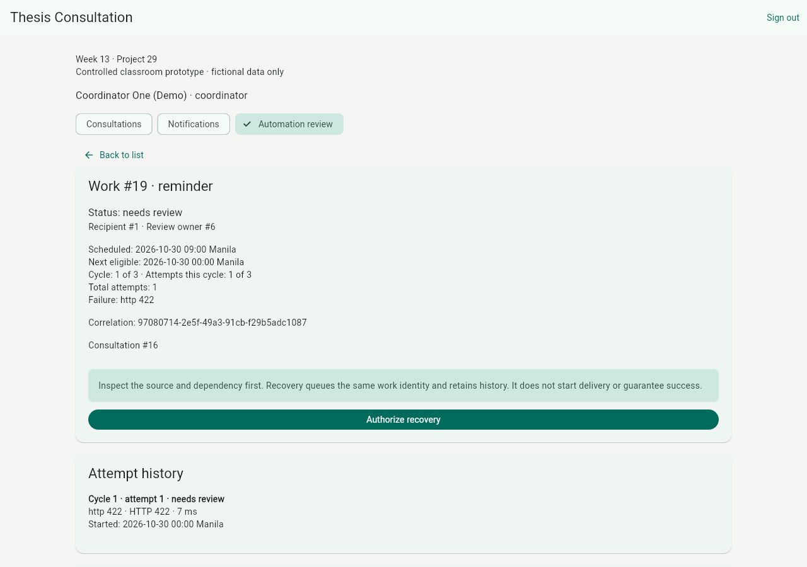

WEB-11. A controlled receiver422 sends reminder work19 to coordinator review with its retained failed attempt. This is a fictional controlled service, not real message delivery.

Source image: evidence/screenshots/application/w13-permanent-failure-review.jpg. Historical browser captures belong to checkpoint07; the source capture is checkpoint08.

## Evidence capture 6 Recovered reminder and receipt history

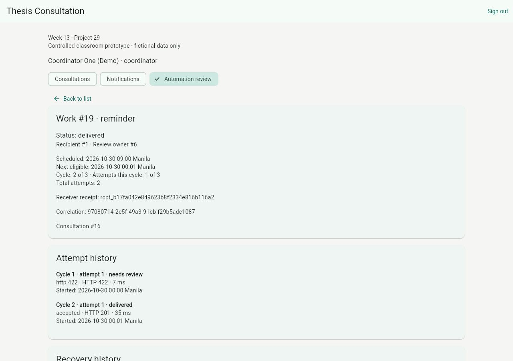

WEB-11. After the cause was corrected, authorized coordinator recovery and a bounded worker call produced one accepted receipt for work19. Prior failure history remains. Receiver acceptance does not establish email delivery or reading.

Source image: evidence/screenshots/application/w13-recovery-delivered.jpg. Historical browser captures belong to checkpoint07; the source capture is checkpoint08.

## Evidence capture 7 Missed session notice

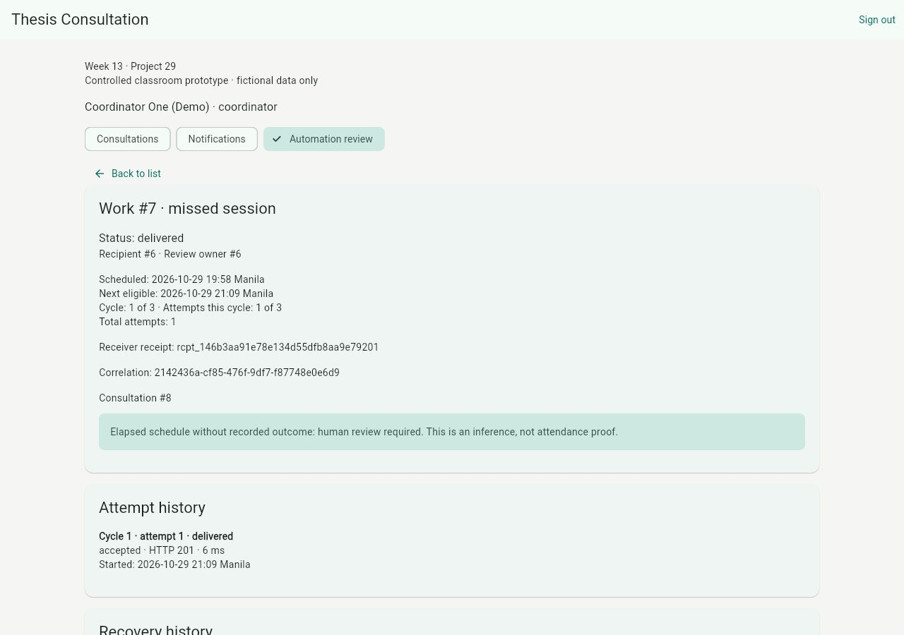

WEB-13. Actual missed-session notification states that the inferred outcome needs human review. It is not proof of attendance or an academic penalty.

Source image: evidence/screenshots/application/w13-missed-session-notice.jpg. Historical browser captures belong to checkpoint07; the source capture is checkpoint08.

## Evidence capture 8 Action item deadline notice

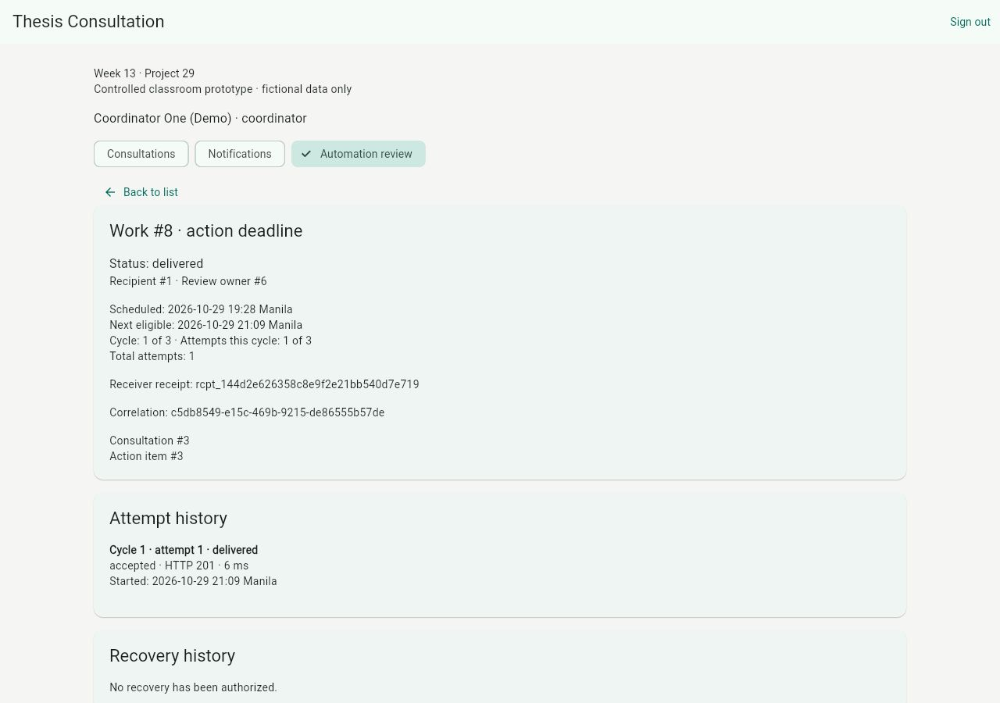

WEB-13. Actual deadline notification links the recorded overdue action and consultation. It demonstrates the notice view alongside the separately recorded scan and receiver evidence.

Source image: evidence/screenshots/application/w13-action-deadline-notice.jpg. Historical browser captures belong to checkpoint07; the source capture is checkpoint08.

## Evidence capture 9 Progress summary at tablet width

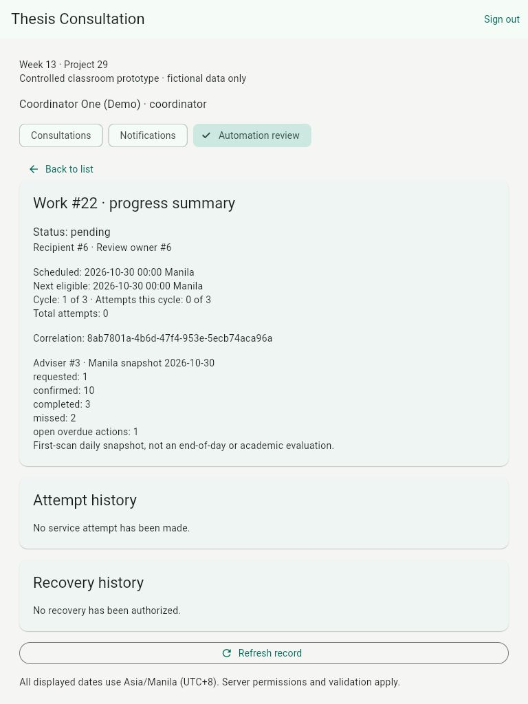

WEB-12. Actual768×1024 tablet view shows the dated Manila-day summary. This new snapshot was pending with no attempts at capture, so this image does not prove its delivery.

Source image: evidence/screenshots/application/w13-progress-summary-tablet-768.jpg. Historical browser captures belong to checkpoint07; the source capture is checkpoint08.

## Evidence capture 10 Controlled unavailable service feedback

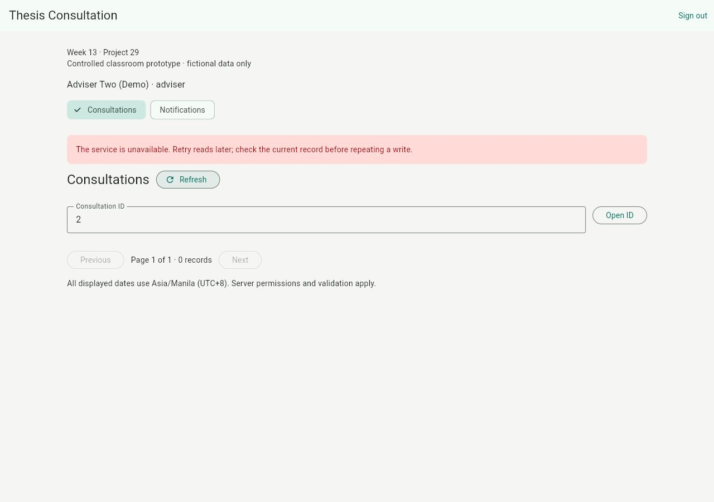

WEB-17. Actual Flutter UI shows safe503 feedback after a temporary read-only stand-in delayed its response. The real Laravel service was subsequently restored; the stand-in is not normal startup configuration.

Source image: evidence/screenshots/application/w13-api-controlled-503.jpg. Historical browser captures belong to checkpoint07; the source capture is checkpoint08.

## Evidence capture 11 Narrow screen notification history

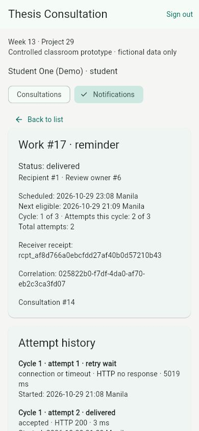

WEB-06. Actual390×844 view shows the recorded timeout and retry receipt history with wrapped content. This selected layout does not certify every screen size or full accessibility.

Source image: evidence/screenshots/application/w13-notification-history-narrow-390.jpg. Historical browser captures belong to checkpoint07; the source capture is checkpoint08.
